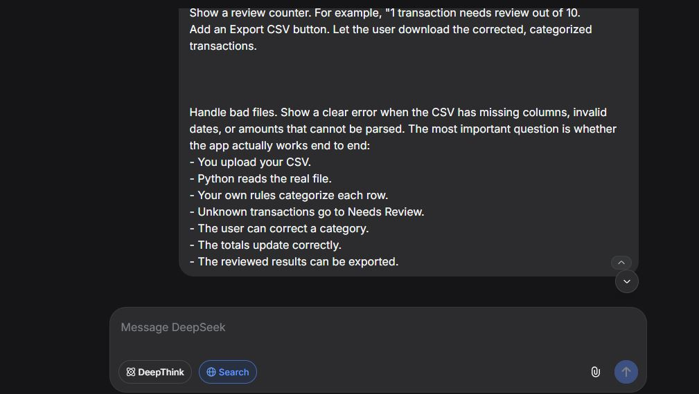
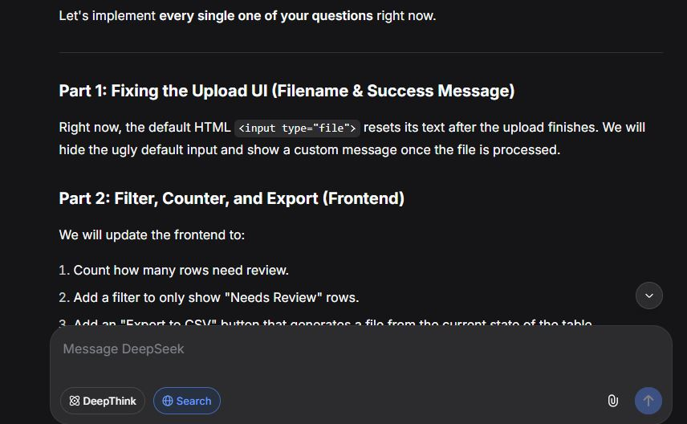

# AI Usage Log

## Tools Used
- **DeepSeek** - Used as an AI coding assistant throughout the development process.

## How it helped
- **Scaffolding:** DeepSeek helped generate the initial FastAPI routes, the Next.js frontend structure, and the Pytest boilerplate.
- **Regex Generation:** DeepSeek assisted in writing the regex patterns for the normalization engine (e.g., stripping out store numbers, POS prefixes, and dates).
- **UI/UX Design:** I used DeepSeek to generate the modern dark-mode CSS and React UI layout, transforming a plain HTML table into a professional dashboard.
- **End-to-End Features:** DeepSeek provided the logic to catch malformed CSVs, add the "Needs Review" filter, track the review counter, and build the CSV export functionality.

## Where it got things wrong (and how I fixed them)
- **Next.js Security:** DeepSeek initially suggested an older version of Next.js (`14.2.3`) in the `package.json`, which triggered a critical security vulnerability warning. I had to manually research and upgrade it to the patched version (`14.2.35`).
- **Brain Logic priority:** While brainstorming, the AI initially suggested categorizing "AMAZON REFUND" as "Income" because it just pattern-matched the word Amazon. I had to manually intervene and enforce the money-flow priority order in the engine, ensuring Refunds are checked *before* standard merchant mapping.
- **File Input Behavior:** The initial UI code hid the filename and reset the input field after processing. I had to manually write the React state logic to display the uploaded filename and show a success message.

## Token Usage & Logs
*DeepSeek's web interface does not display a raw token counter, so I have attached screenshots of the interaction as proof of usage.*

Here is a screenshot of the interface being used to plan the end-to-end architecture:

Here is a screenshot of the conversation where we ensured the strict requirements (bad file handling, review counter, export CSV) were met:

