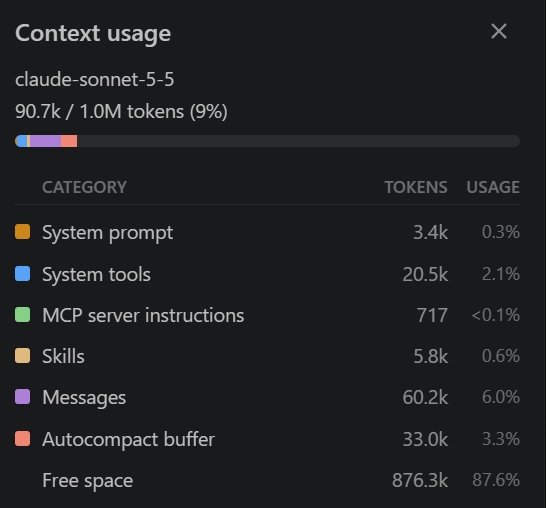
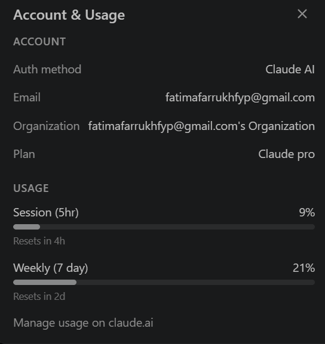

# AI Usage

## Tools used

- **Claude Code** (Claude Sonnet 5.5, in VS Code): scaffolded the project, wrote the parser,
  categorizer, API, React UI, tests and docs, under my direction.

No AI model is used at runtime. The categorizer is hand-written rules and checks, as the task requires.

## How it helped

- Proposed the project structure and the layered decision order (user fix, rules, sanity checks, threshold).
- Wrote the first versions of the parser, rules, API, React components and the pytest/vitest tests.
- Suggested edge cases (refund vs income, transfers, duplicates, d/m date ambiguity, CSV formula injection).

## Where it got things wrong (and how it was fixed)

- **Rule ranking.** The first rule ordering let `UBER` (Travel, 0.93) beat `UBER EATS`
  (Meals, 0.90), because ranking is by confidence first. Caught by running the sample statement
  and reading the output; fixed by raising the specific rule's confidence, and covered by a test.
- **Over-confident generic words.** `CAFE` was first treated as a confident Meals keyword,
  so the task's own "unknown merchant" example (`JOES CAFE 9921`) was silently categorized.
  Lowered generic words to 0.6 so they go to review with a suggestion.
- **A conflicting rule** (`UBER ONE` at lower confidence) could never win; it was dead code and
  was removed.
- A shell command writing the test files failed because of quoting, so the files were written with
  the editor tool instead.

## Verification I did

- Ran the backend on a fake statement and read every categorized row.
- 48 backend tests (pytest) and 3 frontend tests (vitest) pass; the frontend production build succeeds.

## Token usage

My Claude Pro plan does not show separate input/output token totals, so I am attaching the two
usage screens it does provide, copied as shown rather than estimated.

**Context usage at the end of the build session** (token counts, `docs/usage/claude-code-context.png`):
90.7k of 1.0M tokens in the context window (9%): system prompt 3.4k, system tools 20.5k,
MCP instructions 0.7k, skills 5.8k, conversation messages 60.2k.

**Account usage** (`docs/usage/claude-code-usage.png`): 9% of the 5-hour session limit and
21% of the weekly limit. The weekly figure also includes my other Claude use, not only this project.

| Tool | Tokens used in this build session | Evidence |
|---|---|---|
| Claude Code (Sonnet 5.5, Claude Pro plan) | about 90.7k tokens in the context window (60.2k of them conversation) | `docs/usage/claude-code-context.png`, `docs/usage/claude-code-usage.png` |
