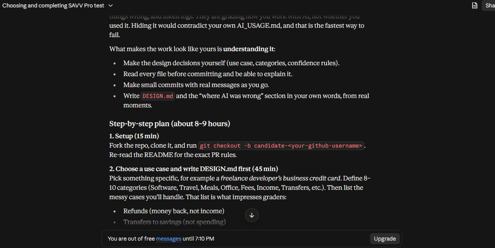

# AI Usage

## Tools used

- **Claude** (claude.ai chat). I used it for the whole project: planning the
  phases, writing the code for each phase, writing tests, and explaining the
  code and commands. I did not use Copilot or any other tool.

The AI wrote most of the code. I did not write it from scratch. My work was to
choose the direction, run every phase on my own machine, read the output, report
failures, and commit phase by phase. The AI is **not** used inside the app:
the categorizing logic is plain Python rules and scoring.

## How the AI helped

- Suggested five possible use cases with their messy edge cases. I picked the
  landlord one.
- Proposed the phase plan: setup, design, sample data, project skeleton, CSV
  parser, categorizer brain, mortgage split, API, React frontend, docs.
- Wrote each phase's code and tests, and explained the key decisions (why
  Decimal instead of float, why uncertain rows go to review, why totals are
  computed only by the backend).
- Walked me through running and checking the app, for example testing the API
  in Swagger UI and testing the UI end to end.

## Where the AI got things wrong or I had to fix things

1. **Duplicate row pointed at itself.** In the API output, row 60 said
   "Possible duplicate of row 60". The AI had stored the CSV line number
   (header counts as line 1) while the output ids start at 1, so they were
   off by one. I only saw it because I read the real JSON response, and the
   AI's own tests did not catch it. Fixed by storing the output index, and
   confirmed in the UI, which now says "row 59". I added a regression test,
   `test_duplicate_points_to_the_row_it_duplicates` in
   `tests/test_duplicates.py`.
2. **Empty `rules.py` file.** One phase failed because `rules.py` was empty
   on my machine. The cause was on my side: I had pasted the code but not saved
   the file. The AI had tested its version first and it worked. Since then I
   keep VS Code Auto Save on and check file sizes with `dir`.
3. **Different test counts.** The AI ran the tests in its own environment and
   reported 42 passing, while my full suite was larger (64 after the mortgage
   phase, 86 after the API phase) because it did not have all of my files. I
   used my own `pytest` output as the source of truth, not the AI's number.
4. **Frontend code was not run by the AI.** The AI told me the React phase
   was not tested on my repo. I ran it myself and checked the numbers by hand
   against the API.
5. **Swagger test confusion (a usage problem, not wrong code).** Swagger
   pre-fills the optional `loan` field with the word `string`, which the API
   correctly rejected with a 422. I had to clear the field. This showed that
   the API's validation works.

## How I verified the AI's output

- Ran `pytest` after every phase and used my own result, not the AI's.
- Tested the API manually in Swagger UI. Without loan details, 15 rows need
  review. With the loan details, 3 do.
- Checked the totals by hand: mortgage interest (-$11,933.19) plus principal
  (-$2,456.01) equals -$14,389.20, which is exactly 12 payments of $1,199.10.
  The security deposit received and returned nets to $0.00. The $120 plumbing
  refund reduces Repairs & Maintenance instead of counting as income.
- Tested the UI: upload, adding loan details afterwards, fixing a Needs Review
  row (the totals moved by exactly that row's amount), and uploading a wrong
  file type.

## Token usage

Claude's chat interface does not show a token count per message, so I cannot
give exact token numbers and I have not estimated any. The screenshots below
show the usage information my account displays, and the full conversation was
a long multi-phase chat covering all ten phases.

