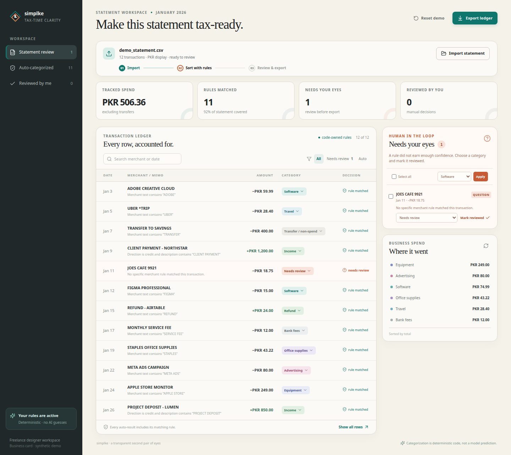

# AI usage

## Tools used

I used Manus coding tools to:

- inspect the starter repo;
- write the React app and Python backend;
- write tests and fake data;
- run checks and build the app.

## How AI helped

The tools helped plan the upload flow, review queue, totals, export, and tests.

They also helped spot important cases:

- refunds are not income;
- transfers are not spending;
- duplicates need review;
- unknown merchants should not get a wrong category.

## What needed fixing

The starter page was only a demo screen, so it was replaced.

A broad cafe rule would have categorized `JOES CAFE 9921`. That was too risky, so the rule was narrowed and the row now goes to Needs review.

A database was considered, but the final app does not need one.

## Tokens and screenshot

The tool did not provide an exact input/output token count. The token total is **unavailable**, and no number was guessed.

This screenshot was captured with the webdev Preview tool:



Checks run:

```text
pnpm check
pnpm test
pnpm build:static
python3 -m unittest discover -s backend -p 'test_*.py'
```

The category brain uses code only. No large AI model makes category decisions.
