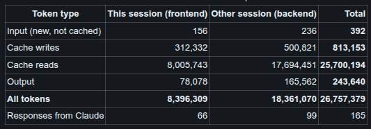

# AI usage

## Tools

| Tool | Model | Used for |
| --- | --- | --- |
| Claude Code, VS Code extension, session A | Claude Opus 5.5 | Settling gaps in the SRS/SDS, backend (ingest, brain, rules, API, reports), evaluation, PDF reading, sample files, docs |
| Claude Code, VS Code extension, session B | Claude Opus 5.5 | Frontend (Next.js page and components), the first sample CSV |

No AI model is used inside the app. The categorizer is plain Python plus YAML rules (see [DESIGN.md](DESIGN.md)).

## How I worked with it

1. **Spec first.** I wrote the requirements (`docs/SRS.md`) and the design (`docs/SDS.md`) before any code, then asked Claude to read them together with `TASK.md` and list the gaps. It found eight, for example:
   - A refund like `SHELL OIL REFUND +20` could never match the Shell rule, because that rule only matched money out.
   - The rule format could not say "send this to review with this reason" (needed for `UBER BV`).
   - Two rules in the same layer could match one row and create a fake conflict.

   We settled each gap in the SDS before writing code.
2. **Cutting scope.** I chose to build a working core first (one CSV layout, the full brain, review, totals, export) and treat extra layouts, Docker and other extras as Phase 2. That is written into the SRS as "Delivery phases".
3. **Two sessions in parallel.** I ran two Claude Code sessions at once: one on the backend, one on the frontend. They agreed a file split (backend/ vs frontend/ + sample_data/) and an API contract by messaging each other, so they never edited the same files. The frontend session tested every endpoint against the live backend and reported back.
4. **Tests as the safety net.** Every messy case from the SRS (E1–E20) has a test, and there is an evaluation with a held-out set and a CI gate. I asked for this so I could let the AI refactor freely and still know nothing broke.

## Where the AI got things wrong (and how it was caught)

| What went wrong | How it was caught | Fix |
| --- | --- | --- |
| The rule ordering ("longer pattern wins") made `UBER TIPS PAYOUT` a plain payout, because the payout regex happened to be longer than the tips regex | Claude noticed it while checking the sample file against the rules | Added an explicit `priority` field; tips rank first |
| The SDS said keywords are "medium" (can't decide alone), but SRS case E9 needs `SQ *JOES CAR WASH` to be decided automatically | Running the sample file through the brain | Unambiguous keywords (`CAR WASH`, `PARKING`) are strong; vague ones (`GAS`) stay medium |
| `--5` was read as **+5**: two minus signs cancelled out | A test the AI wrote for bad amounts failed | Amounts with more than one minus sign are refused |
| A shop named `TOTAL WINE & MORE` would be read as the "Total" footer, silently dropping every row after it | Found while rewriting the parser for readability | Only the first cell (where a data row has its date) is checked for footer words; regression test added |
| PDF tables without grid lines cut long descriptions short (`ONLINE TRANSFER TO SAVINGS` became `ONLINE TRANSFER T`), which silently turned a transfer into an unknown merchant | Comparing each generated sample PDF with its CSV | Replaced pdfplumber's column guessing with placement based on the header positions; a test now checks every sample PDF against its CSV |
| Rule reasons showed raw regexes to the user (`Known merchant ^(UBER\|DOORDASH…`) | Reading the first end-to-end output | Rules can carry a readable `reason` |

## What I decided myself

- **Persona, scope and phases:** the driver persona, the categories and their tax-form lines in the SRS, and building a working core first.
- **The main principle:** "A wrong guess is worse than asking". That drives the strict decision policy.
- **Two sessions:** splitting the work across two parallel sessions.
- **PDF support:** adding text-based PDFs (generated fake PDFs only, no real statements) and the extra sample and broken files for manual testing.

## Token usage

