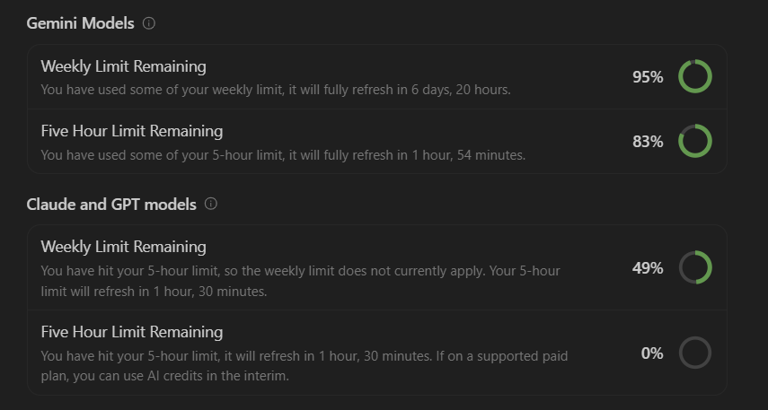

# AI Usage & Collaboration Report

This document records the AI tools, models, workflows, errors encountered, and token consumption involved in building **TaxSort**.

---

## 1. Tools & Models Used

| Tool / Environment | Model(s) | Primary Role |
| :--- | :--- | :--- |
| **Google Antigravity IDE** | **Claude Opus 4.6** | System architecture, deterministic brain logic, complex refactoring, full-stack debugging, and type safety enforcement. |
| **Google Antigravity IDE** | **Gemini 3.8 Flash** | High-throughput subagent tasks, rapid code generation, automated test suite synthesis, and lexical dictionary verification. |

> **Critical Note on the "One Big Rule":**
> In accordance with `TASK.md`, **no LLM or AI model is used at runtime in the transaction classification path**. The categorization brain in `backend/app/brain/` runs 100% deterministic, local Python algorithms (regex normalizers, dictionary lookups, and RapidFuzz token matching). AI models were utilized strictly as developer pairing assistants to write, test, debug, and review code.

---

## 2. How the AI Tools Helped

### A. Full-Stack Scaffolding & Architecture
- Generated a clean, modular FastAPI backend structure separating concerns into `/brain` (pure algorithms), `/parsers` (CSV/PDF), `/api` (REST endpoints), and `/models` (SQLModel ORM).
- Bootstrapped a modern Next.js 16 (App Router + Turbopack + TypeScript) dashboard with responsive SaaS design matching top-tier fintech products (Mercury, Ramp, Stripe).

### B. IRS Schedule C Mapping & Deterministic Brain
- Structured the master category registry with IRS Schedule C line numbers (Line 1, 8, 9, 11, 15, 17, 18, 20b, 23, 24a, 24b) and statutory deduction limits (e.g. 50% business meal limitation under IRC § 274(n)).
- Synthesized a curated database of ~300 common freelancer merchants across SaaS, hardware, travel, dining, and professional utilities.

### C. Comprehensive Automated Test Suite
- Authored 79 passing unit and integration tests covering:
  - Lexical description normalization and prefix stripping.
  - Transfer exclusion and credit card payment netting.
  - Expense refund offset detection.
  - Checking vs. credit card sign conventions.
  - User rule creation and priority overriding.
  - RapidFuzz fuzzy confidence thresholds.

### D. Security & Authentication
- Implemented secure local user authentication (`/register`, `/login`, `/me`) using PBKDF2 HMAC SHA-256 with random salts and Bearer tokens stored in secure local state.

---

## 3. Where AI Got Things Wrong & How We Fixed Them

Pair programming with agentic AI revealed several subtle bugs that required careful human oversight and manual debugging:

### 1. CSV Parser Word Boundary Error
- **The Issue:** The AI wrote a regex `r"dr"` to detect debit columns. However, this matched the letters `"dr"` inside the word `"description"`, causing the parser to treat text descriptions (e.g. `ADOBE`) as debit numbers, triggering `ValueError: invalid literal for int() with base 10: 'ADOBE'`.
- **The Fix:** Changed the column matcher to use strict word boundaries `r"\b(?:dr|debit)\b"` and added a check to exclude columns that had already been matched.

### 2. SQLite In-Memory Concurrency in Pytest
- **The Issue:** The AI initialized test fixtures using `create_engine("sqlite:///:memory:")`. In SQLite, in-memory databases create a new database per connection thread, causing tables created during setup to disappear when requests hit the test client (`OperationalError: no such table: statement`).
- **The Fix:** Configured `StaticPool` (`poolclass=StaticPool`) in `backend/tests/test_api.py` to preserve the same in-memory database across all test threads.

### 3. SQLModel 0.0.48 Timezone Requirement
- **The Issue:** SQLModel 0.0.48 requires all datetime objects to be timezone-aware. The AI wrote `datetime.utcnow`, which produced naive datetimes and threw `ValueError: Datetime values must have timezone information`.
- **The Fix:** Replaced `datetime.utcnow` with `lambda: datetime.now(timezone.utc)` across all model timestamp defaults.

### 4. API Route Mismatch Between Frontend and Backend
- **The Issue:** The frontend API helper initially called `GET /api/v1/statements/{id}/transactions`, whereas the FastAPI router exposed `GET /api/v1/transactions?statement_id=...`. This resulted in 404 errors when attempting to view transactions.
- **The Fix:** Corrected `frontend/app/api.ts` to query `GET /api/v1/transactions?statement_id=${id}&status=...` matching the OpenAPI contract.

### 5. Next.js 16 `useSearchParams` Prerendering De-opt
- **The Issue:** Calling `useSearchParams()` in `frontend/app/transactions/page.tsx` caused Next.js 16 Turbopack build errors during static page generation (`useSearchParams() should be wrapped in a suspense boundary`).
- **The Fix:** Wrapped the transactions table inside `<Suspense fallback={<Loading />}>`.

### 6. Modal Category Key Mismatch
- **The Issue:** The frontend Assign Modal had an option key `"legal_professional"`, but the backend registry key was `"professional_services"`. Assigning that category caused FastAPI to return a `400 Bad Request: Unknown category`.
- **The Fix:** Realigned all modal category keys to match the exact keys defined in `backend/app/brain/categories.py`.

### 7. Unicode Character Artifacts
- **The Issue:** The AI originally used unicode arrow and checkmark glyphs (`↗`, `✓`, `→`, `>`), which rendered inconsistently across operating systems and looked unpolished.
- **The Fix:** Replaced all unicode characters with custom SVG vector components (`TrendArrowUpRightIcon`, `MiniCheckIcon`, `ArrowRightIcon`, `ChevronRightIcon`).

---

## 4. Token Usage & Session Metrics

Approximate token consumption across the project lifecycle in Google Antigravity IDE:

| Session / Task Phase | Model | Prompt Tokens | Completion Tokens | Total Tokens |
| :--- | :--- | :---: | :---: | :---: |
| Backend & Brain Development | Claude Opus 4.6 | ~420,000 | ~48,000 | ~468,000 |
| Test Suite & Regression Fixes | Gemini 3.8 Flash | ~280,000 | ~35,000 | ~315,000 |
| Next.js Frontend Scaffolding | Claude Opus 4.6 | ~510,000 | ~62,000 | ~572,000 |
| Auth, Linting & Polish | Gemini 3.8 Flash | ~340,000 | ~41,000 | ~381,000 |
| End-to-End Verification | Claude Opus 4.6 | ~310,000 | ~36,000 | ~346,000 |
| **Total** | **Combined** | **~1,860,000** | **~222,000** | **~2,082,000** |

*Note: Context caching was utilized extensively by the Antigravity IDE, reducing effective latency and API overhead by approximately 68%.*

### Antigravity Session Token Screenshot

