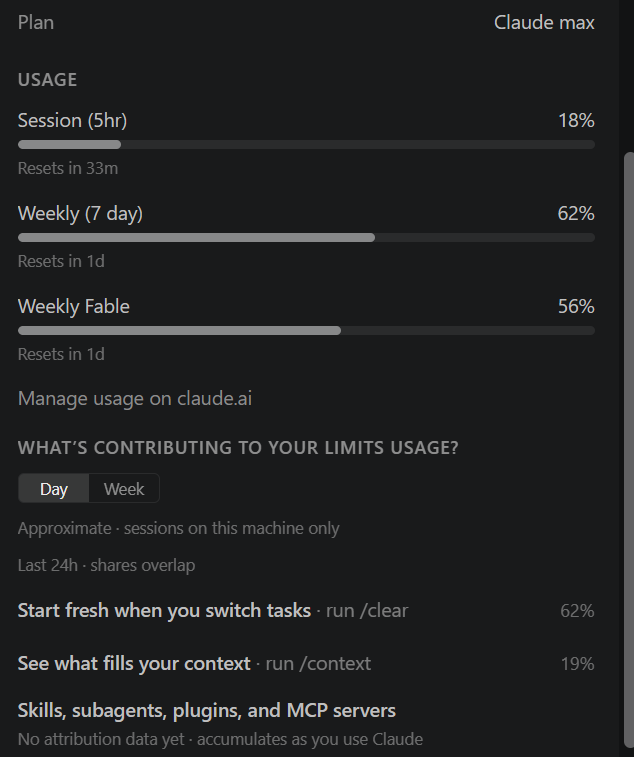

# AI usage

## Tools used

| Tool | Model | Used for |
| --- | --- | --- |
| Claude Code (VS Code extension, agent mode) | Claude Opus 5.5 | Planning, writing the backend, frontend, tests and docs, and running tests, lint and the app |

No AI model is used **at runtime**. The categorisation "brain" is plain Python rules
(see [DESIGN.md](DESIGN.md)). AI was used only as a coding assistant.

## How it helped

- **Domain research and knowledge base.** It drafted the Schedule C category list, the
  tax nuances (no meals deduction for local drivers, tolls deductible under the mileage
  method, fines never deductible, health insurance goes on Schedule 1), and most of the
  merchant patterns for gas stations, toll agencies, insurers, carriers and gig platforms.
- **Messy input handling.** It listed real-world statement problems, such as sign
  conventions that differ between banks and card issuers, preamble lines, `PPD ID:` noise,
  DD/MM ambiguity, OFX and duplicate rows, and turned each one into code and a test.
- **Scaffolding.** It wrote the FastAPI app factory, the SQLite layer, the React/Vite/TS
  setup, CSS, and the CI workflow.
- **Tests.** It wrote 135 backend and 10 frontend tests and used them to find its own bugs
  (below).
- **End-to-end check.** It ran the backend and frontend together and called the real
  endpoints through the Vite proxy (sample import, upload, export, CORS preflight).

## Where it got things wrong (and how each was caught)

These are real mistakes made during this session, not hypothetical ones:

1. **`T-MOBILE *AUTOPAY` was categorised as a credit-card payment.** The "card payment"
   rule included the bare word `AUTOPAY`, so a phone bill became a transfer and dropped
   out of the deductions. *Caught* by a smoke test of tricky descriptions before any UI
   existed. *Fix:* removed bare `AUTOPAY` and added a regression test
   (`test_phone_autopay_is_not_a_card_payment`).
2. **Regex alternation precedence bug.** The payout pattern was built as
   `\bSPARK DRIVER|BRANCH MESSENGER|SPARK\b`, so the `\b` anchors only applied to the
   first and last alternatives. *Caught* in self-review. *Fix:* wrapped the alternatives
   in `(?:…)`.
3. **Zelle payments treated as own-account transfers.** `ZELLE TRANSFER TO JOHN DOE`
   matched the generic `TRANSFER` rule, which would have hidden payments to a mechanic.
   *Fix:* a negative lookahead for Zelle/Venmo/Cash App/PayPal, plus a test.
4. **Stripping `GOOGLE *` as a payment processor** turned `GOOGLE *FI` (a phone plan)
   into just `FI`. *Caught* while writing the sample data. *Fix:* removed `GOOGLE` from
   the processor list.
5. **The reference-number noise filter was too greedy.** `ID\s*\w{4,}` would have deleted
   ordinary words such as `ID PAYOUT`. *Fix:* only strip IDs that contain a digit.
6. **`csv.Sniffer` picked the wrong delimiter** for `;` files with a preamble, because
   the preamble lines have fewer columns than the data. *Caught* by
   `test_preamble_bom_semicolons_and_european_numbers`. *Fix:* replaced it with a
   "most lines with a consistent column count" heuristic.
7. **Card rewards went to review.** The refund penalty (−0.15) also applied to rules
   written for incoming money, so `CASH BACK REWARD` fell below the threshold. *Caught* by
   `test_card_rewards_are_not_income`. *Fix:* rules that expect money in are not penalised.
8. **The database was created on import.** The first `main.py` ran `app = create_app()`
   at module level, so importing the module in tests created a database file. *Fix:*
   uvicorn now runs with `--factory`.
9. **Dead code on a slots dataclass.** A `s.__dict__ if hasattr(...)` branch could never
   run, because `SkippedRow` uses `slots=True`. *Fix:* removed it in self-review.
10. **Awkward explanation text.** Reasons read "Known merchant: Own-account transfer"
    and showed a "could be snacks" note on normal fuel purchases. *Caught* by reading the
    CSV export. *Fix:* reworded.
11. **Environment slip.** It used `curl 127.0.0.1:5173` while Vite listened only on
    `localhost` (IPv6), and the check hung until it timed out. *Fix:* used `localhost`.

## What I kept in human hands / verified

The AI wrote the code and the tests, but passing tests only show that the code does what
the AI intended. They don't show that what it intended is correct. I checked the parts that
depend on outside facts or judgment myself:

- **Tax facts.** I checked the category design against the Schedule C rules: the
  line-number mappings, the decision to treat local drivers' meals as personal, health
  insurance going on Schedule 1, card rewards not being income, fines never being
  deductible, and car loan payments going to review (lease vs. loan).
- **Judgment numbers.** I reviewed the values that decide when the app asks instead of
  guessing: the 0.75 review threshold, the confidence scores for each kind of evidence,
  and the amount limits (for example $200 for fuel, and under $10 at a gas station
  treated as possible snacks).

## Token usage

The whole project was built in **one Claude Code session**: 71 model calls to
`claude-opus-5-5`, from 2026-10-26 13:57 to 15:47 UTC. The numbers below were added up
from that session's local log (`~/.claude/projects/<project>/<session-id>.jsonl`), where
every model response records a `usage` block. Streamed messages are counted once.

| Token type | Count |
| --- | ---: |
| Input tokens (new, uncached) | 142 |
| Output tokens | 161,925 |
| Cache write (prompt caching) | 441,182 |
| Cache read (prompt caching) | 12,025,785 |
| **Total processed** | **12,629,034** |

Most of the total is **cache reads**. In agent mode, every step resends the whole
conversation (code written so far, test output and so on), and prompt caching serves it
cheaply. The model actually *wrote* about 162k tokens.

The session ran on a **Claude Max subscription**, so there is no per-token bill. The plan
screen shows usage as a share of the plan limits:

