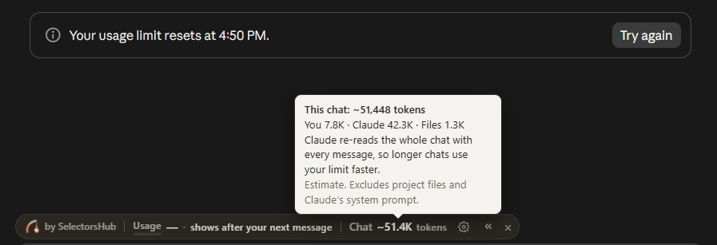
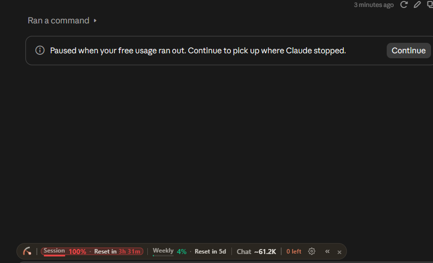

# AI Usage

## Tools

- **Claude** (Anthropic) through the claude.ai web chat only, across more than one account (one was used only for brainstorming). No CLI or agent tool (Claude Code, Codex, Cursor and so on). I copied every file into the project myself.
- No other AI tool was used.

## The big rule

No AI model runs inside the app. The categorizer is plain Python rules (see [DESIGN.md](DESIGN.md)) and there are no API keys. AI was only used to help me understand the task and write the code and docs.

## How it helped

- Explained `TASK.md` and turned it into a PRD, which the AI then followed to build the project.
- Talked through the use case and what goes wrong on real statements (refunds, transfers, duplicates, sign conventions, messy descriptions).
- Helped design the order of checks in the categorizer and the confidence threshold.
- Wrote first drafts of the backend, the tests, the React frontend, the README and DESIGN.md.
- Late in the project, checked the README, DESIGN.md and AI_USAGE.md against the code, and wrote the Dockerfiles, `docker-compose.yml` and GitHub Actions workflow. I had not set up CI or Docker before, so it also walked me through where the files go and how to run them.

## How I worked with it

1. **PRD, then prototype.** The AI built a working prototype from the PRD first. It ran, the tests were green and the sample statement looked right.
2. **I read the code file by file and tried it myself,** in the code and in the browser. Most of the problems below came from this. I did not let the green tests decide anything.
3. **I fixed what I found** one piece at a time, as complete files I could read before moving on.
4. **Second review.** I asked the AI to judge the whole project against `TASK.md` and common sense, and told it not to just agree with me or defend its own code. This found bigger problems than the first pass. I also told it to remove anything the task did not need, which removed the saved-rules feature.

I ran every command on my own machine (Windows, PowerShell) and pasted the output back. In the review session Claude also had a code sandbox and ran the tests, break-it inputs, the mutation checks below and the real server. I re-ran the tests, lint and build myself afterwards. My prompts told it to question its own design and say what could be wrong. When something looked wrong, I had it read the existing code before suggesting changes.

## Where the AI got things wrong

All of these were found by reading the code, trying inputs on purpose, or using the app in the browser, not by the tests.

1. **A rule that could never match.** `rules.py` had a `CARD PAYMENT` pattern, but the normalizer strips a leading `CARD`. Removed.
2. **Dead end on duplicates.** Duplicate flagging had no way for the user to clear a false alarm. Fixed with `keep_rows` and a `duplicate_of` field.
3. **Saved-rules feature nobody asked for.** While running the app, a JSON file I had not asked for kept appearing in the project. It came from a "remember this merchant forever" feature the task never asked for (a JSON file, three endpoints, a UI list and its own tests). The first version could not be viewed or undone, so one click on Amazon made every future Amazon row automatic. I had the AI add a list and a Remove button. On the second review the real problem showed: rows only reach review because the merchant does *not* decide the category (Amazon, cafes, Uber Eats), so a rule per merchant is wrong for exactly those rows. It also ignored the direction of the money, so a saved Amazon rule auto-filed an Amazon refund at confidence 1.0. The AI built a feature, then a patch for the feature, and neither was needed. I removed all of it. The user now changes a category per row and nothing is stored.
4. **A wrong answer could not be fixed.** Only Needs Review rows had a dropdown, so a row the brain was confidently wrong about was stuck. Now every row can be changed, with an Undo.
5. **No way to say "personal" or "other".** Only nine business categories existed. Added `Personal (not business)` (left out of totals) and `Other Business Expense`.
6. **Sign auto-detect flipped a whole file on a row count.** A month with 3 purchases and 4 client payments looked "flipped", so payments became unknown expenses and income showed 0. It now uses rows from known business merchants as evidence, and with none it keeps the signs and says it was a guess. `59.99 CR` and `59.99 DR` both used to read as +59.99 and `1e5` as 15. Direction is now read and letters are rejected with a warning.
7. **The brain was confidently wrong.** Every rule had a fixed confidence (0.95 for ADOBE, HILTON, AUTOPAY and so on), which says how good the rule is, not how sure we are about this row. Inputs written to trip it:

| Input | Before | Now |
|---|---|---|
| `HILTON GARDEN PIZZA` -30 | Travel, 0.95, auto. "Longest match wins" compared characters, so HILTON beat PIZZA. | Needs Review, names both categories. Conflicts are asked, never decided by length. |
| `AVIS BEAUTY SALON` -60 | Travel, 0.95 | Needs Review. The rule is `AVIS RENT A CAR`, not the loose word `AVIS`. |
| `AUTOPAY GYM MEMBERSHIP` -30 | Excluded and left out of the totals | Needs Review. The rule is `AUTOPAY PAYMENT`. |
| `INVOICE FROM LANDLORD` +2500 | Income, 0.9 | Needs Review. The rule is `INVOICE PAYMENT`. |
| `ZOOM` +5000, `AIRBNB PAYOUT` +900 | Treated as a refund, reducing a spending category | Needs Review. Money in from a known merchant is a refund only if the description says refund, return, reversal, credit or chargeback. |
| `GOOGLE*ADS1234567890` | Unknown merchant | Advertising. A name stuck to a long number keeps the name. |
| `TRANSFER TO SAVINGS ACCOUNT OF BOB` -500 | Excluded | **Still excluded.** The known phrase matches as a prefix. Rejecting every extra word would break real lines like `TRANSFER TO SAVINGS ACCT 1234`. Listed in DESIGN.md under known limitations. |

   The brain will still be wrong sometimes. The fixes are to ask when it sees a conflict and to let the user change any row (item 5).
9. **A bug in the AI's own fix.** While fixing item 7 it stripped "currency codes" with a pattern that matched any three letters, so `12.50 abc` read as 12.50. A new test caught it. Limited to real currency codes.

## On AI-written tests

The AI wrote the tests to fit the code, so they passed and proved little. Almost every case was an input the code was built for: a clean known merchant (`ADOBE CREATIVE CLOUD`), an obviously unknown one (`ZXQV HOLDINGS`), a tidy refund. The autopay test used `AUTOPAY PAYMENT`, the exact string the rule was written for, and nothing tested `AUTOPAY GYM MEMBERSHIP`. The first 79 tests were green while items 5 to 8 were true.

I had it ask "what real input would make this wrong?" instead: a known word inside a different business, a payment method that looks like a merchant, money in that is not a refund, a month with more payments in than purchases, an amount with letters in it. The suite is now 109 tests, and `sample_data/tricky_cases.csv` holds several of these inputs.

To check the new tests can fail, I broke the code on purpose and re-ran them: conflict check off, all money-in treated as refunds, the user's choice on duplicates ignored, and the row-count sign guess back. Each made tests fail. The first attempt at the conflict check made only one test fail, because the food rule is weak enough to reach review anyway, so those tests were passing by luck. I added one with two confident rules that disagree (`ZOOM HILTON CONFERENCE`).

There are no frontend tests. The frontend is checked with `npm run lint`, `npm run build` and by hand.

## Manual testing

I ran the tests, lint and build on my machine and used the app in the browser. The two files in `sample_data/` give these results with the current code:

- `freelancer_card.csv`: 17 rows, 8 categorized, 2 excluded, 7 needs review, no warnings.
- `tricky_cases.csv`: 12 rows, 7 categorized, 5 needs review, no warnings. The 5 are `HILTON GARDEN PIZZA`, `AVIS BEAUTY SALON`, `AUTOPAY GYM MEMBERSHIP`, `INVOICE FROM LANDLORD` and `ZOOM` +5000.

## Token usage

The claude.ai web chat does not show token counts, so I used the SelectorsHub token counter browser extension, which estimates tokens per chat. I used three chats across my Claude accounts, including the brainstorming one. These are estimates: the extension leaves out Claude's system prompt and project files, and Claude re-reads the whole chat on every message, so the tokens actually processed are higher.

Screenshots are in `docs/usage/`.

| Chat | Estimated tokens | Screenshot |
|---|---|---|
| Chat 1 | ~51.4K | `chat-token-estimate-1.png` |
| Chat 2 | ~61.2K | `chat-token-estimate-2.png` |
| Chat 3 | ~85K | `chat-token-estimate-3.png` |
| **Total** | **~197.6K** | |