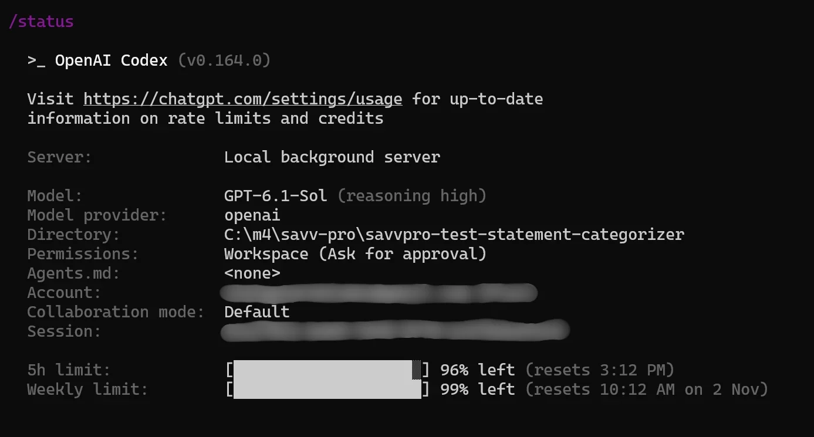
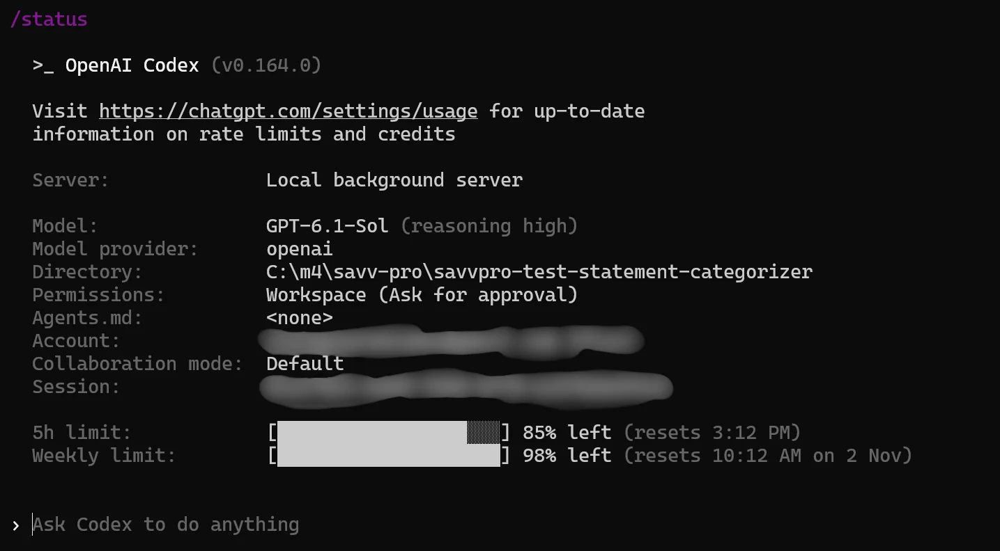
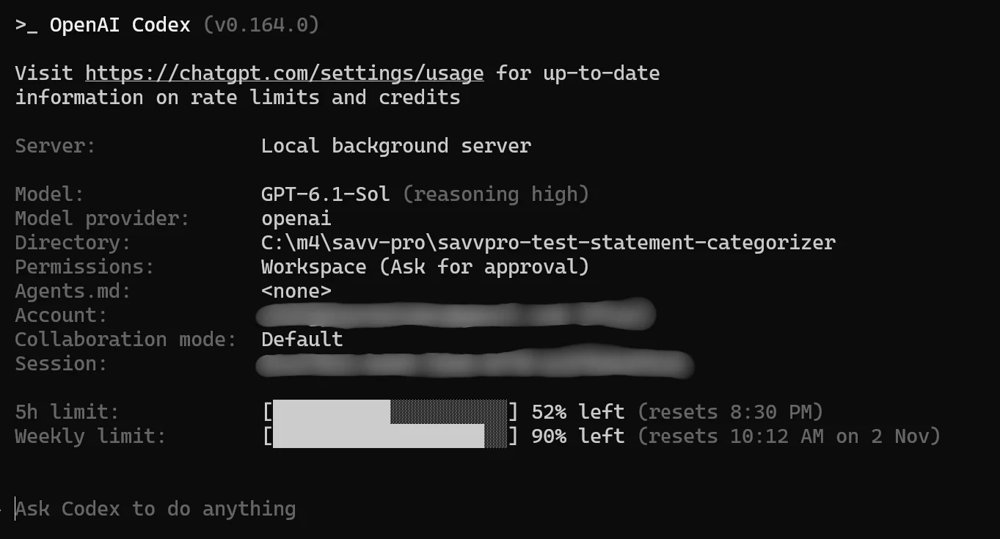

# AI assistance

## Tools and model evidence

ChatGPT helped turn the assessment requirements into the supplied development brief. The exact ChatGPT model was not recorded.

Codex assisted with implementation, refinement and the final audit. The genuine status screenshots below identify the selected model as **GPT-6.1 Sol with High reasoning effort**. The final audit used parallel review agents for backend, frontend, and documentation checks. Runtime categorization uses explicit, deterministic Python rules. No AI model or external financial API is involved in transaction classification.

## Work assisted

Codex helped implement CSV validation, category rules, FastAPI endpoints, SQLite persistence, the React dashboard, tests and documentation. The refinement added PKR support, conservative handling of local bank payments, independent duplicate confirmation and responsive transaction editing. Codex also ran verification commands and inspected the resulting output and browser layouts.

## My decisions and review

I chose the Pakistani freelance developer use case and directed the PKR localization. I reviewed the application interface and development reports, identified areas needing improvement, and guided changes to financial classification, duplicate handling and mobile usability. I also ran the application locally to inspect its behavior. Codex assisted with implementation and automated verification, while I made the product and submission decisions.

## Problems found and corrected

- Extra blank rows in the initial sample files caused validation failures. The samples were corrected and tested.
- Generic supplier transfers were initially treated as internal account movements. Rules now require explicit own-account evidence, with regression tests for supplier, contractor, IBFT and Raast payments.
- Duplicate confirmation initially reused category correction. It now has its own persisted flag and endpoint; each decision is tested independently.
- The final audit found that conflicting client-payment and refund wording could be treated as a refund. These conflicting indicators now require review, with focused regression tests.
- The original mobile table hid editing controls off screen. Responsive stacked rows now expose amounts, categories, statuses and confirmation controls.
- Windows launcher aliases and the PowerShell npm shim caused setup issues. Verification used the actual Python executable and `npm.cmd`.
- A single Vitest thread worker reduced slow Windows test startup. The installed Starlette test client still emits a non-blocking httpx deprecation warning, which was not suppressed.

## Verification performed

These were tool-executed checks, not independent human financial or tax review:

- `python -m pytest -c backend/pytest.ini -q`: 103 backend tests passed, with one upstream deprecation warning.
- `npm.cmd test`: eight frontend interaction tests passed, including a rejected category save that preserves the previous category and totals.
- `npm.cmd run typecheck` and `npm.cmd run build`: passed.
- Ruff checks for errors, unused imports, import ordering and common bug patterns passed. Ruff and Prettier were temporary local tools, not added application dependencies.
- An isolated copy installed fresh Python and frontend dependencies, passed the same tests and build, and started with an empty PKR database. This used the same Windows host, Python 3.11 and Node 24; it was not a cross-platform verification. The production npm dependency audit reported zero vulnerabilities.
- Chrome and Playwright checked the real API and built frontend: both PKR samples, exact totals, search and filters, category corrections, independent duplicate confirmation, reload persistence, full export despite filters, invalid-currency rejection and statement selection. Category editing and overflow checks passed at 390px and 768px. Desktop layout was also inspected. No browser page errors were observed.
- Development made two initial GETs per endpoint under StrictMode, then remained idle. The production build made one initial GET per endpoint. StrictMode was retained.
- A controlled single SIGINT shut down Uvicorn cleanly. Two SIGINTs 20ms apart reproduced the reported KeyboardInterrupt/CancelledError shutdown trace. No application exception suppression, signal handling or dependency changes were added.
- Git review checked the candidate branch, unchanged task, ignored local artifacts and preserved EUR database. No commit, push or pull request was made during development or refinement.

Public deployment, real bank data, cross-browser testing and tax compliance were outside verification.

## Usage evidence

The initial and mid-work images were inspected. They show the selected model and remaining five-hour and weekly usage-limit percentages. Those percentages are not token counts. Account and session fields in the supplied evidence are blurred.

The local main-session log recorded **929,031 total tokens** at 2026-10-26 16:39:51, including cached input. The extracted [token-count record](docs/ai-usage/session-token-usage.json) preserves that measurement. It is a main-session snapshot, not a final combined total across ChatGPT and all review agents. A combined aggregate and billing total were unavailable; no estimates are presented as measured consumption.

### Initial usage

### Mid-work usage

### Final usage

