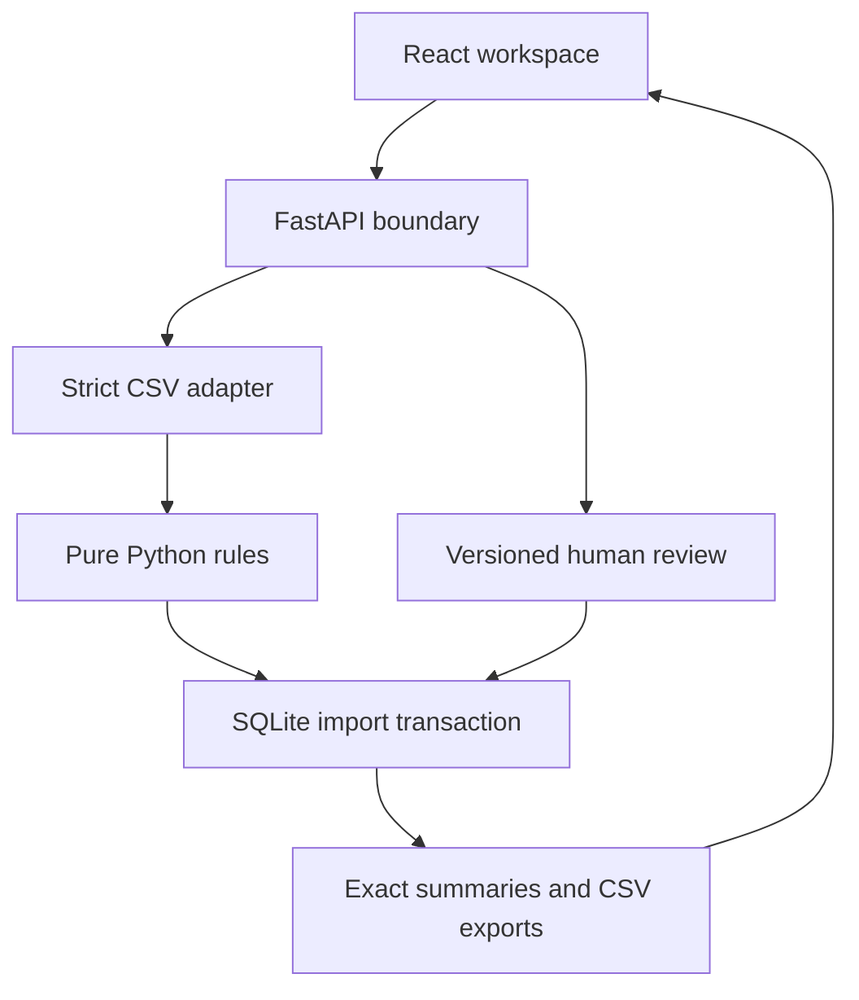

# Design: conservative categorization for a freelance designer

## Customer and completed job

The customer is an independent designer using a **dedicated business bank or credit-card account**. They want to hand an organized statement and category totals to their accountant, without treating savings transfers as expenses or merchant refunds as revenue.

The completed workflow is upload → normalize → categorize → review → export. The app persists the work, explains decisions, preserves corrections, and prevents a final export with unresolved rows. It does not calculate taxes. The business-account assumption is explicit: an Adobe or Uber charge is a bookkeeping suggestion and can still be changed to Personal.

The dataset consists only of invented transaction records. Familiar merchant names identify rule examples, not real customer activity.

## Architecture and boundaries

| Module | Responsibility | Deliberately does not do |
| --- | --- | --- |
| `domain.py` | Category/movement vocabulary and immutable inputs | HTTP or database operations |
| `parser.py` | Validate CSV; normalize dates and signed integer money | Infer a category or guess a locale |
| `engine.py` | Deterministic decisions, reason, rule ID, strength | Network access, AI, persistence, user learning |
| `store.py` | Atomic imports, deduplication, optimistic edits, audit | Silently remove rows or train rules |
| `reporting.py` | Accepted totals, reconciliation, safe CSV | Infer deductibility or exchange rates |
| `main.py` | Validate HTTP inputs, request limits, routes | Implement the categorization logic |
| React components | Present data, collect decisions, handle states | Recompute authoritative financial totals |

The engine is a pure function over a normalized transaction. Its result is independent of user edits and previous imports. Duplicate/pending flags are attached during import and can force review even when the merchant rule is strong.

## The brain, in order

1. Normalize merchant text with Unicode NFKC, uppercase, and punctuation/whitespace normalization. Keep the original description too. Digits remain in normalized descriptions for conservative duplicate matching.
2. Abstain on zero amounts or explicitly truncated descriptions.
3. Abstain on reversals, chargebacks, disputes, rewards/cashback, ATM, and cash-withdrawal wording. The engine cannot know their accounting context.
4. Recognize explicit internal transfers and card-payment wording. Generic “TRANSFER FROM CLIENT” is not enough: transfer-to/from rules require own-account wording such as Savings or Checking. Card payments are excluded to avoid counting both the purchase and payment.
5. Match a small set of anchored, boundary-aware merchant rules. If matches point to different categories, abstain.
6. For money in: require explicit refund/return wording plus a recognizable merchant for an automatic refund. A refund with an unknown merchant needs its original expense category. All other credits need review; a known merchant name alone does not prove a refund, and a client-like description does not prove income.
7. For money out: refund wording conflicts with the sign, so abstain. Otherwise accept a specific merchant rule, retain its provisional category if review is required, or return Needs Review.
8. The persistence layer adds pending/duplicate evidence. Any such flag forces review; pending rows cannot be accepted into totals.

No probabilistic model sits behind these rules. There are no LLM calls, embeddings, external classifiers, or merchant-enrichment services.

## Category and evidence examples

| Evidence | Proposed category / movement | Review? | Reason |
| --- | --- | --- | --- |
| `ADOBE CREATIVE CLOUD`, negative | Software / expense | No | Specific known subscription on a business account |
| `UBER *TRIP`, negative | Travel / expense | No | Explicit ride descriptor, not a generic Uber charge |
| `UBER EATS`, negative | Meals / expense | Yes | Food purchase needs business-purpose context |
| `STAPLES`, negative | Office supplies / expense | Yes | Mixed-use retailer; inspect receipt |
| `GOOGLE ADS`, negative | Marketing / expense | No | Explicit advertising product |
| `WIRE TRANSFER FEE`, negative | Bank fees / expense | No | A fee is spending, not a transfer |
| `TRANSFER TO SAVINGS`, either sign | Transfers / transfer | No | Explicit own-account movement |
| `CREDIT CARD PAYMENT`, either sign | Transfers / transfer | No | Excluded from purchases and income |
| `ADOBE CREATIVE CLOUD REFUND`, positive | Software / refund | No | Reduces Software expenses; no Income |
| `REFUND UNKNOWN SHOP`, positive | Needs Review / refund | Yes | Refund known, category unknown |
| `CLIENT PAYMENT DEMO STUDIO`, positive | Needs Review / unknown | Yes | Credit source requires confirmation |
| `JOES CAFE 9921` | Needs Review / unknown | Yes | Unknown merchant, no business-purpose evidence |
| `AMAZON`, `PAYPAL`, generic `APPLE.COM/BILL` | Needs Review / unknown | Yes | Marketplace/processor descriptors are too broad |
| Exact date/description/amount/currency repeat | Original suggestion + duplicate flag | Yes | Could be duplicate export or a genuine second purchase |

## Confidence is rule strength, not a probability

`confidence` is a fixed explainability value displayed as **Strength: n/100**. It is not “96% likely to be tax deductible.” There is no claimed statistical calibration.

- .99: explicit internal transfer or card-payment wording.
- .94–.98: narrowly recognized expense descriptors.
- .93: recognizable merchant plus explicit positive refund.
- .65–.70: a plausible category requiring a receipt/purpose check, such as Meals or Office supplies.
- .00–.50: unknown or conflicting evidence; review required.

Every rule specifies whether it needs review. There is no hidden global threshold to override a pending/duplicate flag. A high-strength merchant rule is not enough to accept a flagged transaction. Stable IDs and `engine_version` preserve the rationale that actually produced each import; future code updates do not rewrite saved decisions automatically.

## Accounting invariants

- Persisted money uses **integer cents**, normalized so money out is negative and money in is positive. `Decimal` parses exact input before integer storage. Floating-point values are used only for presentation of already-bounded integer amounts and rule strengths.
- Bank-signed, card-signed, and separate debit/credit CSVs become the same domain representation. Date/sign/currency conventions are explicit inputs.
- An accepted expense is negative and uses an expense category. A refund is positive and uses an expense category. Income is positive with category Income. Transfers and Personal are excluded from business expenses in either direction.
- Category net expense = accepted gross spending − accepted refunds. A refund can exceed this import's spending and produce a negative net total. No forced match to a same-period purchase is made.
- Unresolved and explicitly excluded rows never enter accepted category totals. They remain in the ledger and transaction export.
- Raw statement net = accepted net + unresolved net + excluded net. Accepted cash flow includes transfers/personal money, so it is not the same number as business expenses.
- “Final” means all rows have decisions, not that an accountant approved a return.

The server validates category/movement pairs and signs. The UI's helpful defaults cannot bypass these checks. Zero-valued and pending rows can only be resolved by exclusion with a note. User overrides of already accepted rows are allowed and audited.

## Bad input and duplicates

Parsing is all-or-nothing. The parser returns line-specific errors before the first database write. It rejects ambiguous headers, invalid calendar dates, malformed amounts, conflicting debit/credit entries, mixed currencies, unsupported statuses, and binary/non-UTF-8 input. It never silently drops malformed transactions. At most 100 validation errors are returned in one response.

Identical files are recognized by SHA-256; settings must match to reuse an import. SQLite's unique hash and `BEGIN IMMEDIATE` protect this check under concurrent uploads. Row fingerprints hash the normalized date, description, amount, and currency. A match to an unexcluded row creates a **possible** duplicate. It does not remove the row, assume two real purchases are one, or automatically reverse a prior accepted transaction. The first occurrence remains accepted if otherwise eligible; later occurrences wait for review.

If two descriptions differ in meaningful characters or reference numbers, they may not be recognized as duplicates. This favors explainable warnings over risky fuzzy deduplication. Flags are import-time evidence: deleting/excluding an earlier import does not automatically erase a later warning; confirm the later row yourself. Excluded pending rows do not block a newly imported posted version.

## Persistence, revisions, and data lifetime

SQLite is appropriate for the local single-user workload, capped at 5,000 rows per import. WAL mode and short transactions allow reads while reviews/imports commit. Every operation gets its own connection. Parameters bind all values; table names are fixed. Schema version 1 is recorded with `PRAGMA user_version`, and unknown future versions are rejected. A migration framework is intentionally not invented before a second schema exists.

Review payloads include `expected_version`. The server takes a write transaction, verifies the current version, validates accounting invariants, writes the new decision, increments its version, and appends the before/after event atomically. A stale tab receives HTTP 409. The user must refresh before retrying; no last-writer-wins overwrite is allowed. History is append-only through the review API, but deleting an import intentionally cascades to its history. This is not a tamper-proof regulatory audit store.

The app does not retain the original file bytes. It retains transaction content, filename, hash, configuration, original machine decision, user notes, and review history. No real statements or identities are committed to the repository. The local database is ignored by Git and by the deliverable packager.

## Interface decisions

The overview answers three questions: How much accepted spending is there? How much is still unresolved? How much money came back? A separate reconciliation disclosure explains every row's cash-flow bucket. Category bars show accepted net expenses; negative categories remain signed in the labels.

The table retains original descriptions and source line numbers. Search, sorting, filters, and pagination help review a full statement. Every row opens a native modal dialog with its evidence, category, movement, optional note, and explicit exclusion control. Original decisions remain visible in the review history. Loading, empty, error, partial review, complete review, and export states are implemented. Late responses cannot replace a newer statement selection.

## Scope decisions and honest limitations

- **CSV instead of unreliable generic PDF extraction.** Many banks export CSV. Every supported field is validated. PDF/OCR would require bank-specific reconciliation and confidence mechanisms before it could meet the same safety standard.
- **Rules instead of a small trained classifier.** There is no representative labeled dataset. A transparent, narrow ruleset is a better starting point than fabricated ML confidence or broad guesses.
- **One local workspace.** No authentication, tenancy, server encryption, automated backup, or internet deployment claim. Read `docs/SECURITY.md` before extending to hosted use.
- **Selected-statement reporting.** History supports multiple imports, but there is no year-wide aggregation, currency conversion, account ownership model, receipt attachment, or split transaction allocation. A mixed-purpose purchase should remain unresolved until allocated outside the tool, or excluded with a note.
- **No tax-law decisions.** A Meals label does not establish a deduction percentage. Equipment capitalization, sales tax/VAT/GST, jurisdiction rules, and tax filing are outside scope.
- **Bounded scale.** Synchronous local SQLite operations are moved off the async event loop where required. There is no background job queue, distributed lock, fuzzy merchant service, or externally hosted frontend pretending to have a Python backend.

## Tests and extension policy

Pure tests exercise parser/engine/reporting contracts; API tests exercise real SQLite persistence, concurrent import idempotency, version conflicts, atomic failures, and export gates. React tests cover input/feedback behavior. Playwright exercises the real API from a browser, including persisted edits and downloadable CSVs. See `docs/VERIFICATION.md` for results and environment limits.

To add a merchant rule: add a specific anchored pattern, category, stable rule ID, strength, reason, and explicit review policy. Add a positive example, a near-collision negative example, and refund/sign tests. Confirm it cannot bypass transfer or special-case precedence. Increase the engine version when decision behavior changes. To add a new bank format: implement an adapter to `ParsedTransaction`, keep the core engine unchanged, and test sign/date/currency/reconciliation cases using fictional exports.
