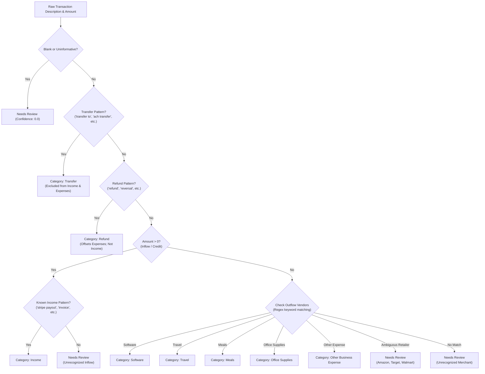

# Architecture & Design Document

## 1. Chosen User Type & Problem Space

### Target User
The application is built for **independent freelancers, remote developers, and freelance designers** who operate as sole proprietorships or single-member LLCs.

### Problem
At tax preparation time (Schedule C / business expense review), freelancers must comb through hundreds of credit card and bank transactions. Common challenges include:
- Mistaking an internal transfer (e.g. transfer to a tax savings account) for a deductible business expense or taxable income.
- Treating a refund (money returned from an airline or vendor) as gross business income, which artificially inflates tax liability.
- Guessing categories on mixed-use merchants (e.g., Amazon orders containing both personal items and office monitors).
- Accidentally deleting duplicate transactions that occurred on the same day.

Our application solves this by providing **deterministic categorization**, **explicit audit trails**, **strict financial integrity rules**, and **instant inline correction with real-time recalculation**.

---

## 2. Architecture & Data Flow

```mermaid
flowchart TD
    User["Freelancer / User"] -->|Uploads CSV Statement| UI["React 18 + Vite Frontend"]
    UI -->|POST /api/statements/upload| API["FastAPI REST API"]
    
    subgraph Backend Services
        API --> Parser["CSV Parser & Sanitizer"]
        Parser -->|Row Validation| Brain["Deterministic Categorization Engine"]
        Brain -->|Decisions + Audit Rules| Store["In-Memory Statement Store"]
        Store -->|Calculate Summary| Metrics["Financial Summary Engine"]
    end

    Metrics -->|JSON: Transactions + Summary| UI
    UI -->|Render Dashboard| User

    User -->|Inline Category Correction| UI
    UI -->|PATCH /api/transactions/{id}| API
    API --> Store
    Store -->|Recalculate Summary| Metrics
    Metrics -->|Updated Transaction + Summary| UI
```

### Flow Breakdown
1. **File Ingestion**: The frontend sends a multipart form upload to `POST /api/statements/upload`.
2. **Sanitization & Normalization**: `parser.py` validates required headers (`Date`, `Description`, and either `Amount` or `Debit`/`Credit`), decodes UTF-8/BOM, cleans currency symbols (`$`, `€`, `(50.00)`), and validates dates.
3. **The Categorization Brain**: `categorizer.py` executes transparent, ordered rule evaluations. It produces a `Decision(category, confidence, status, matched_rule)`.
4. **Summary Aggregation**: `store.py` computes total income, gross expenses, refunds, net expenses, net cashflow, and exclusions (transfers).
5. **Interactive Review**: The React frontend displays metric cards, a spending breakdown bar, and a searchable table. When a user changes a dropdown, a `PATCH` request updates the transaction and recalculates summary totals instantly without full page reloads.

---

## 3. Categorization Brain: Rules & Decision Strategy

The engine is **100% deterministic local Python code**. No external LLM or AI model is contacted.

### Decision Hierarchy



### Handling Specific Cases

| Case | Handled Category | Rationale & Tax Implication |
|---|---|---|
| `ADOBE CREATIVE CLOUD` | `Software` | Standard SaaS tool for design work; 100% deductible business expense. |
| `UBER *TRIP` | `Travel` | Transportation vendor; categorized under Travel. |
| `TRANSFER TO SAVINGS` | `Transfer` | Internal account movement. Excluded from expenses and income to prevent double-counting or false deductions. |
| `REFUND FROM AWS` (+35.00) | `Refund` | Crucial: a refund is money returned from an earlier expense. Counting it as income falsely increases gross revenue and tax liability. It reduces net expenses instead. |
| `AMAZON.COM*8B3120` | `Needs Review` | Big-box merchants frequently contain mixed personal/business purchases. It is unsafe to guess automatically. |
| Empty / `None` / `""` | `Needs Review` | Flagged immediately with a 0.0 confidence score and alert warning. |
| Unrecognized deposit (+250.00) | `Needs Review` | Inflows without clear client invoice indicators must not be blindly assumed to be taxable income (could be a personal gift, capital injection, or loan). |

---

## 4. Financial Calculations

$$\text{Gross Income} = \sum (\text{Transactions with Category } = \text{Income})$$

$$\text{Gross Expenses} = \sum |\text{Transactions with Category } \in \{\text{Software, Travel, Meals, Office Supplies, Other, Spending in Needs Review}\}|$$

$$\text{Total Refunds} = \sum |\text{Transactions with Category } = \text{Refund}|$$

$$\text{Net Deductible Expenses} = \max(0, \text{Gross Expenses} - \text{Total Refunds})$$

$$\text{Net Cashflow} = \text{Gross Income} + \text{Total Refunds} - \text{Gross Expenses}$$

$$\text{Transfers (Excluded)} = \sum |\text{Transactions with Category } = \text{Transfer}|$$

---

## 5. Trade-offs, Assumptions & Limitations

1. **In-Memory Store vs Database**:
   - *Choice*: In-memory singleton store for zero-config simplicity.
   - *Trade-off*: State is wiped when the backend process restarts. Acceptable for a single-session tax statement upload and review tool.
2. **Rule-Based Regex vs ML Model**:
   - *Choice*: Deterministic regex/keyword rules.
   - *Trade-off*: Fast, explainable, zero false hallucinations, and runs offline without API keys or costs. Requires expanding keyword lists over time for new regional merchants.
3. **Debit / Credit Normalization**:
   - *Choice*: Expenses stored as negative numbers, deposits as positive numbers.
   - *Trade-off*: Consistent internal math regardless of whether the source CSV provided a single signed column or dual Debit/Credit columns.
