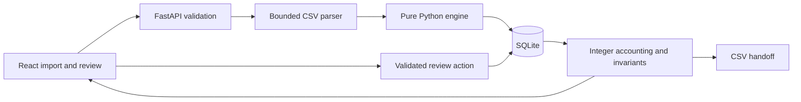

# LedgerLens design

## Product decision

Independent consultants need a trustworthy handoff, not a tax oracle. A statement description often identifies a vendor without proving business purpose. LedgerLens favors inspectable rules and selective abstention over aggressive coverage. Human decisions are first-class records and never erase the original evidence.

CSV was selected because the assessment does not require PDF and reliability is more valuable than extraction breadth in a timed exercise. Python/FastAPI and React/TypeScript satisfy the required stack. SQLite provides durable local state without provisioning a database server. No runtime model, embedding service, or network classifier participates in decisions.

## Architecture



`importer.py` validates file syntax and interpretation. `engine.py` is pure classification. `service.py` owns transactional operations. `summaries.py` is the sole accounting implementation. `main.py` handles transport and export. The frontend formats already-calculated minor units; it never calculates authoritative financial totals.

The application deliberately uses a few direct modules rather than generic repositories, background queues, or domain frameworks. Classification of up to 5,000 bounded rows is synchronous. Browser table pagination renders 40 rows at a time; data remains available for next-review navigation.

## Import accountability

The user confirms column mapping, date format, currency, and amount direction. Header suggestions only suggest column names, not financial meaning. The preview shows original cells. Standard-library `csv.reader` handles quoting and tracks physical source line numbers, including multiline cells.

Validation precedes database writes. A malformed row produces a source-line error and aborts the whole import. Blank lines are counted. Unexpected field counts, ambiguous numeric formats, invalid calendar dates, absent descriptions, nonfinite numbers, excessive precision, and conflicting debit/credit entries are rejected. Original descriptions are retained verbatim; normalized descriptions are stored separately.

Amounts are parsed using `Decimal` and stored as integer minor units. Negative means outgoing from the account holder's perspective. The per-row bound also keeps all permitted aggregate values inside JavaScript's exact-integer range, though the browser still does not do accounting.

The import fingerprint includes both source bytes and interpretation settings. Identical imports are idempotent. `BEGIN IMMEDIATE` serializes duplicate-check/insertion, and the database also enforces fingerprint uniqueness. Row records are inserted in one transaction. A changed mapping is a distinct interpretation and can produce a separate statement; totals are never combined across statements.

## Deterministic decision engine

The rules are data in `backend/app/rules.json`, with unique IDs, categories, phrases, evidence strengths, and context requirements. They are validated at startup. Runtime classification contains no sample-row identifiers, expected fixture labels, or merchant/amount pairs.

Normalization applies Unicode NFKC, case folding, punctuation boundaries, and whitespace collapse. It deliberately does not strip arbitrary digits or payment-processor prefixes: over-normalization can merge unrelated merchants. Exact phrase tokens match inside normalized text, not arbitrary substrings (`FIGMATIC` does not match `FIGMA`).

Decision order:

1. A stored explicit review remains the effective decision; the engine result is immutable.
2. Zero amounts require review.
3. Conflicting semantic markers or a marker inconsistent with direction require review.
4. Specific transfer or income markers can establish kind.
5. Unexplained incoming credits abstain, even if a known merchant is present.
6. Expense/refund category evidence is evaluated across **all** matching rules.
7. Different categories produce a conflict, independently of rule order.
8. Specific compatible evidence may categorize; weak evidence or contextual merchants require review.

A score of 95 indicates specific configured evidence; 70 indicates weaker suggestion; 0 indicates insufficient category evidence. These are heuristic strengths, not statistical confidence or accuracy estimates. Contextual rules such as rides and meals require confirmation even when merchant evidence is strong. There is no fuzzy fallback.

Each decision includes kind, category, review status, strength, matched IDs, phrases, explanation, review reason, and engine version. The UI distinguishes engine decisions from user confirmation and exposes a compact trace.

### Refunds and transfers

A positive amount alone never proves revenue. An explicit refund marker on an incoming row identifies a refund, but an unknown expense category remains unresolved. A refund marker on an outgoing row is a semantic conflict. A refund offsets expenses rather than increasing income; refunds can legitimately exceed purchases in the current statement.

Specific account-transfer markers are excluded from spending. Generic `PAYMENT` or `TRANSFER` is insufficient. Merchant evidence combined with a transfer marker is treated as a conflict. Income uses narrow markers such as client invoice payment; unknown credits require a person to choose their purpose.

The rule catalog is intentionally limited. The engine can still be wrong when a descriptor is misleading; users may correct automatic decisions. It does not infer jurisdictional deductibility, split transactions, or allocate partially business purchases.

## Duplicate review

Within a statement, equal date, signed amount, and conservatively normalized full description identify candidate groups. This is evidence of similarity, not proof of duplication. No row is automatically removed.

Each candidate starts pending. A user explicitly keeps it or excludes it; both actions can be undone. At least one copy must remain included. A category correction does not automatically resolve the duplicate warning. Pending candidates contribute to cash movement and unresolved amounts, not accepted category totals.

Cross-statement matching is excluded because repeat purchases, overlapping exports, and account transfers require account identity and a broader matching policy.

## Review integrity

A transaction keeps its original engine decision alongside effective kind/category, review state, duplicate disposition, and a monotonically increasing version. Review requests include that version. Stale updates return HTTP 409 instead of silently overwriting another tab's correction. The review panel keeps the error visible on mobile and provides a reload action that retrieves the newer decision and totals without resubmitting the stale edit.

Saving, resetting, or changing duplicate disposition is transactional and appends a before/after audit event. Reset restores the original engine classification; it does not erase audit history or implicitly change duplicate disposition. No background reclassification overwrites manual decisions.

Invalid kind/category pairs and direction conflicts are rejected by the backend. Zero-value rows can be explicitly identified as personal or transfer activity; they cannot masquerade as nonzero income or expense.

## Reconciliation

The summary partitions all included records into accepted expense, refund, income, transfer, personal, or unresolved signed amounts. Excluded duplicate rows are a separate partition.

Invariants asserted on every summary calculation:

```text
imported signed = included signed + excluded signed
included signed = sum(all included kind buckets)
included signed = incoming cash − outgoing cash
net categorized expense = expense debits − expense refunds
net categorized expense = sum(category net amounts)
```

An unresolved item cannot leak into accepted category totals. “Provisional” means at least one review item remains. All-row export is allowed with explicit review/exclusion status. The final reviewed export endpoint returns 409 until all issues are resolved. Both UI summaries and exports use this same aggregation.

## API and storage

FastAPI exposes typed import options and review requests; `/docs` supplies the generated API contract. Primary endpoints are preview, statements, transactions, review, history, summary, and export. SQLite foreign keys cascade only during an explicit statement deletion. Startup creates missing tables and refuses unknown newer schema versions; it does not drop or reset data.

SQLite uses WAL mode, bounded lock waits, parameterized queries, and request-scoped connections. Related reads run in explicit read transactions. The workspace endpoint returns rows and their computed summary in one snapshot; the UI publishes them together. Export completion checks and CSV generation use exactly the same row set, so a concurrent correction cannot authorize a final export containing older unresolved rows. Separate downloads reflect their individual request times. The single-user scope does not justify an ORM/migration framework. A future schema change would require an explicit versioned migration rather than destructive reinitialization.

## Security and privacy

Only synthetic examples are shipped. Uploaded files are bounded and not retained as files; parsed rows are stored locally. No runtime external fonts, analytics, or model calls are required. Cross-site writes are rejected, no wildcard CORS is enabled, and the documented bind address is loopback. Formula-like prefixes in exported untrusted text are escaped; numeric columns remain numeric. React escapes description rendering. Secrets and local database files are ignored by Git.

This is not a hardened multi-user hosted service: there is no authentication, encrypted database, malware scanning, or authorization model. Local users with filesystem access can access the database. Public deployment requires a separate threat model and implementation.

## Verification strategy and limitations

Pure engine/parser tests establish boundary behavior. API tests use isolated temporary databases and check atomic writes, idempotency, corrections, stale updates, duplicate decisions, and reconciliation. Browser tests exercise the compiled frontend and real backend, including mobile and invalid data. Separate challenge cases and metamorphic tests guard against demo-specific behavior. Automated accessibility testing complements visual inspection.

Known boundaries: narrow documented CSV dialect; one two-decimal currency per statement; no PDF/OCR, FX conversion, tax advice, learned merchant rules, cross-account reconciliation, or automatic cross-statement deduplication. A small synthetic evaluation set demonstrates regression behavior, not real-world accuracy. Better bank adapters and configurable remembered rules are future work, not claimed functionality.
