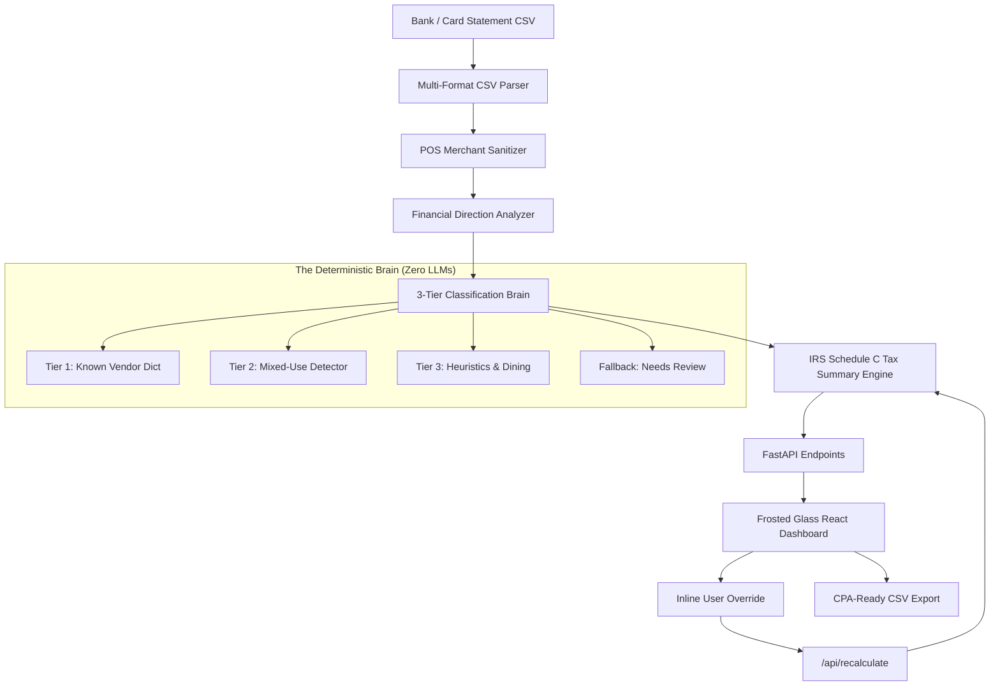
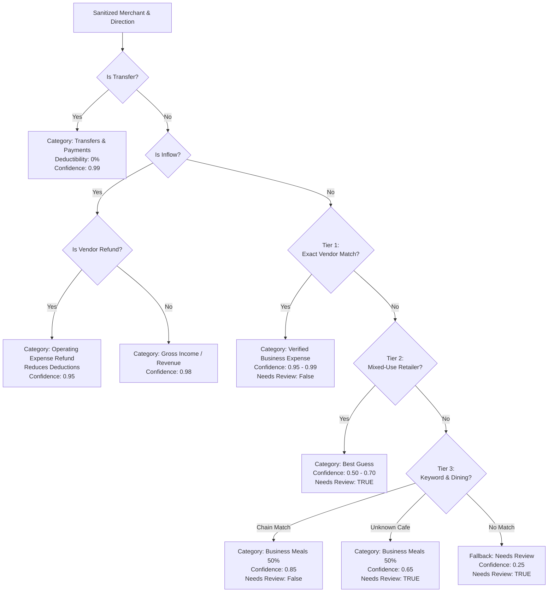

# Design Document — Statement Categorizer

> **Customer Profile:** Freelance Software Engineer & Tech Consultant (Sole Proprietor filing IRS Schedule C)  
> **Architecture Goal:** 100% Deterministic, Audit-Proof Rule Engine with Executive Frosted Glass Interface

---

## 1. Target Use Case

### The Problem
A freelance tech consultant or contract software developer typically runs their business as a sole proprietor (or single-member LLC). At tax time, they must organize hundreds of bank and credit card transactions to complete **IRS Form 1040 Schedule C (Profit or Loss From Business)**.

Their statements are notoriously messy:
1. **Raw POS Noise:** `SQ *BLUE BOTTLE COFFEE SAN FRANCISCO CA`, `CHECKCARD 1024 GITHUB 877-448-4820 CA`, or `DELTA AIR 006245892184 ATLANTA GA`.
2. **Mixed-Use Vendors:** Retailers like Amazon, Apple, and Best Buy could represent legitimate software development hardware (100% deductible under Section 179) or personal household goods (0% deductible).
3. **Complex Tax Rules:**
   - Business meals are only **50% deductible** under IRC § 274(n).
   - Home office internet and mobile phone services are typically **80% deductible** based on business-use ratio.
   - Internal transfers and credit card autopayments are **non-taxable account movements** that must not inflate expenses.
   - Refunds from vendors (e.g., returning an unused monitor) must **reduce expenses**, *never* count as taxable income.

### Core Philosophy
> **"A wrong guess is worse than asking."**  
> Tax errors trigger IRS audits, penalties, and interest. If the system is not confident about a transaction (e.g., an unrecognized local merchant or a mixed-use retailer like Amazon), it must explicitly route it to **Needs Review** and give the freelancer complete, transparent control.

---

## 2. System Architecture

The application follows a clean separation of concerns between an immutable deterministic processing pipeline in Python and a reactive frosted glass client in React.

### Component Breakdown
1. **Multi-Format CSV Parser (`parser.py`):**
   - Automatically detects whether the CSV uses a single signed `Amount` column or separate `Debit` / `Credit` columns.
   - Handles delimiter variations (commas, semicolons), currency symbols (`$`, `€`), quotes, and negative parenthetical accounting notation `($45.00)`.
2. **POS Merchant Sanitizer (`sanitizer.py`):**
   - Strips payment processor prefixes (`SQ *`, `TST*`, `CHECKCARD`, `PAYPAL *`, `POS DEBIT`).
   - Removes store numbers (`#1234`), phone numbers, airport/city codes, dates, terminal IDs, and airline ticket numbers.
   - Normalizes merchant strings into canonical uppercase keys (e.g., `AMZN MKTP US*123` → `AMAZON`).
3. **Financial Direction Analyzer (`direction.py`):**
   - Distinguishes **`OUTFLOW`** (expense), **`INFLOW`** (income), **`REFUND`** (expense credit), and **`TRANSFER`** (non-taxable).
4. **Classification Brain (`classifier.py`, `rules.py`):**
   - Evaluates the transaction against the 3-tier rules engine and generates the category, IRS line, confidence score, and review flag.
5. **Tax Summary Engine (`tax_summary.py`):**
   - Calculates gross revenue, total expenses, net taxable profit, category-by-category totals, and effective deduction rates while strictly applying statutory limits (50% meals, 80% utilities).
6. **FastAPI Layer (`main.py`):**
   - Exposes REST endpoints (`/api/upload`, `/api/recalculate`, `/api/sample`, `/api/categories`).
7. **Frosted Acrylic UI (`frontend/`):**
   - Provides live visualization, interactive review drawers, inline category reassignment, and CSV export.

---

## 3. The Classification Brain

In accordance with assessment rules, the brain is **100% deterministic Python code**. No external AI APIs, LLMs, or non-deterministic heuristics are executed at runtime.

### 3-Tier Decision Pipeline

#### Tier 1: Known Vendor Dictionary (~50 Curated Tech Vendors)
- **Matching:** Exact canonical name or primary prefix lookup against an audited dictionary of tech freelance vendors.
- **Confidence:** `0.95` to `0.99`.
- **Examples:**
  - `GITHUB`, `AWS`, `DIGITALOCEAN`, `VERCEL`, `HEROKU`, `DATADOG` → **Software & Cloud Subscriptions** (Line 27a, 100% deductible).
  - `UBER`, `LYFT`, `DELTA`, `UNITED`, `AMERICAN AIRLINES` → **Travel & Transportation** (Line 24a, 100% deductible).
  - `COMCAST`, `VERIZON`, `AT&T` → **Utilities & Internet (Home Office)** (Line 25, 80% deductible).
  - `WEWORK`, `REGUS` → **Rent & Coworking Space** (Line 20b, 100% deductible).

#### Tier 2: Mixed-Use Vendor Detection (Amazon, Apple, Best Buy, Target)
- **Matching:** Detection of high-volume merchants commonly used for both business development and personal living expenses.
- **Rule:** A wrong tax deduction can invalidate a tax return. Therefore, all Tier 2 transactions are assigned a reasonable initial category with a lower confidence score (`0.50` to `0.70`) and are **always flagged with `needs_review: true`**.
- **Examples:**
  - `AMAZON` → Flagged as *Supplies & Materials* (`0.50` confidence) for user verification.
  - `APPLE` → Flagged as *Hardware & Equipment* (`0.65` confidence).
  - `BEST BUY` → Flagged as *Hardware & Equipment* (`0.60` confidence).

#### Tier 3: Keyword Heuristics & Dining Classification
- **Matching:** Regex pattern matching for business functions (e.g., `CAFE`, `BAKERY`, `RESTAURANT`, `BISTRO`, `COFFEE`, `PARKING`, `FEDEX`).
- **Chain Discrimination:**
  - Recognizable meal chains (`STARBUCKS`, `PEETS`, `CHIPOTLE`, `SWEETGREEN`, `PANERA`) are auto-verified at `0.85` confidence.
  - Independent local eateries (e.g., `JOES CAFE`) match the meal keyword but are assigned `0.65` confidence and flagged for user review to confirm client entertainment intent.

#### Fallback: Needs Review
- Any transaction failing Tiers 1 through 3 is routed to **Needs Review** with a low confidence score of `0.25`. The user is prompted with an inline category drawer to assign the appropriate Schedule C line item.

---

## 4. IRS Schedule C Tax Categories

The engine organizes transactions into **13 formal IRS Schedule C categories**:

| Category Key | Display Name | Schedule C Line | Deductibility % | Typical Freelance Vendors |
|---|---|---|---|---|
| `software_saas` | Software & Cloud Subscriptions | Line 27a (Other) | 100% | GitHub, AWS, Vercel, JetBrains, Figma, Google Workspace |
| `hardware_equipment` | Hardware & Equipment | Line 13 (Depreciation) | 100% | Apple Store, Best Buy, Dell, B&H Photo |
| `home_office_utilities` | Utilities & Internet (Home Office) | Line 25 (Utilities) | 80% | Comcast Xfinity, Verizon Fios, AT&T Internet |
| `travel` | Travel & Transportation | Line 24a (Travel) | 100% | Uber, Lyft, Delta Airlines, United, Amtrak |
| `meals` | Business Meals | Line 24b (Meals) | **50%** | Client lunches, Starbucks, Chipotle, Blue Bottle |
| `advertising_marketing` | Advertising & Marketing | Line 8 (Advertising) | 100% | Google Ads, Meta Ads, LinkedIn Ads, Namecheap |
| `office_supplies` | Supplies & Materials | Line 18 (Office Exp.) | 100% | Staples, Amazon Business, Paperless Post |
| `coworking_rent` | Rent & Coworking Space | Line 20b (Rent) | 100% | WeWork, Regus, Deskpass |
| `legal_professional` | Legal & Professional Services | Line 17 (Legal) | 100% | Stripe Atlas, CPA fees, LegalZoom |
| `contract_labor` | Subcontractors & Labor | Line 11 (Contract Labor) | 100% | Upwork contractors, Fiverr specialists |
| `gross_income` | Gross Income / Revenue | Line 1 (Gross Receipts) | N/A (Inflow) | Stripe Client Payouts, Direct Wire Transfers |
| `refund_credit` | Operating Expense Refund | Line 27a (Offset) | 100% (Offset) | Returned equipment, flight cancellations |
| `transfers_non_taxable`| Transfers & Payments | Non-Taxable | 0% | Credit Card Autopayments, Checking to Savings |
| `needs_review` | Needs Review / Uncategorized | Pending Review | 0% (Hold) | Unrecognized local shops, ambiguous receipts |

---

## 5. Edge Cases Handled

### 1. Refund vs. Income Discrimination
- **Problem:** If a developer buys a $1,200 monitor at Apple and returns it, the bank statement records a +$1,200 credit. Naive categorizers count this as taxable gross revenue, artificially inflating income and taxes owed.
- **Solution:** The `DirectionAnalyzer` inspects positive inflows. If the counterparty matches an operating vendor (or contains `REFUND`, `RETURN`, `CREDIT`), it is classified as `REFUND` (`refund_credit`). In the tax summary, it directly subtracts from total business deductions.

### 2. Credit Card Autopayments and Transfers
- **Problem:** Paying a $3,500 credit card bill from a business checking account shows a $3,500 debit. If treated as an expense, it double-counts all the individual purchases already on the card.
- **Solution:** Autopay patterns (`AUTOPAY`, `PAYMENT THANK YOU`, `TRANSFER TO`, `CHASE CREDIT CRD`) are captured and marked `transfers_non_taxable`. They are excluded from income and expenses.

### 3. Statutory 50% Meals Limitation (IRC § 274(n))
- **Problem:** Many tax organizers sum all meal expenses as deductible.
- **Solution:** The tax engine tracks both gross spend and statutory deductions. A $100 business dinner adds $100 to total expenditures but contributes exactly **$50.00** to the tax deduction summary.

### 4. Raw POS Merchant Prefix Cleaning
- **Problem:** Point-of-sale systems wrap merchant names with terminal prefixes: `SQ *BLUE BOTTLE`, `TST* RITUAL COFFEE`, `CHECKCARD 1014 GITHUB.COM`.
- **Solution:** A 2-stage regex cleaner strips common processor prefixes, store numbers, phone numbers, state abbreviations, and airline ticket numbers before classification.

---

## 6. Frontend Architecture & Design System

The frontend was built to feel like an executive, high-trust financial cockpit:

1. **Frosted Acrylic Glassmorphism:**
   - Soft translucent cards (`rgba(255, 255, 255, 0.72)`) with 25px backdrop blur.
   - Ambient ethereal radial gradient canvas with subtle lavender, slate, and peach undertones.
2. **Radial Arc Gauge & Deduction Analytics:**
   - Semicircular SVG gauge visualizing the overall deduction efficiency ratio.
   - Monthly flow chart contrasting gross revenues against operating deductions.
3. **Interactive Review Drawer:**
   - Attention-needed badge displays exact count of unverified transactions.
   - Clicking any transaction opens a category selector with immediate `/api/recalculate` roundtrip.
4. **CPA-Ready CSV Export:**
   - Exports all processed transactions with original dates, cleaned descriptions, Schedule C line mappings, deductibility percentages, and review flags.
