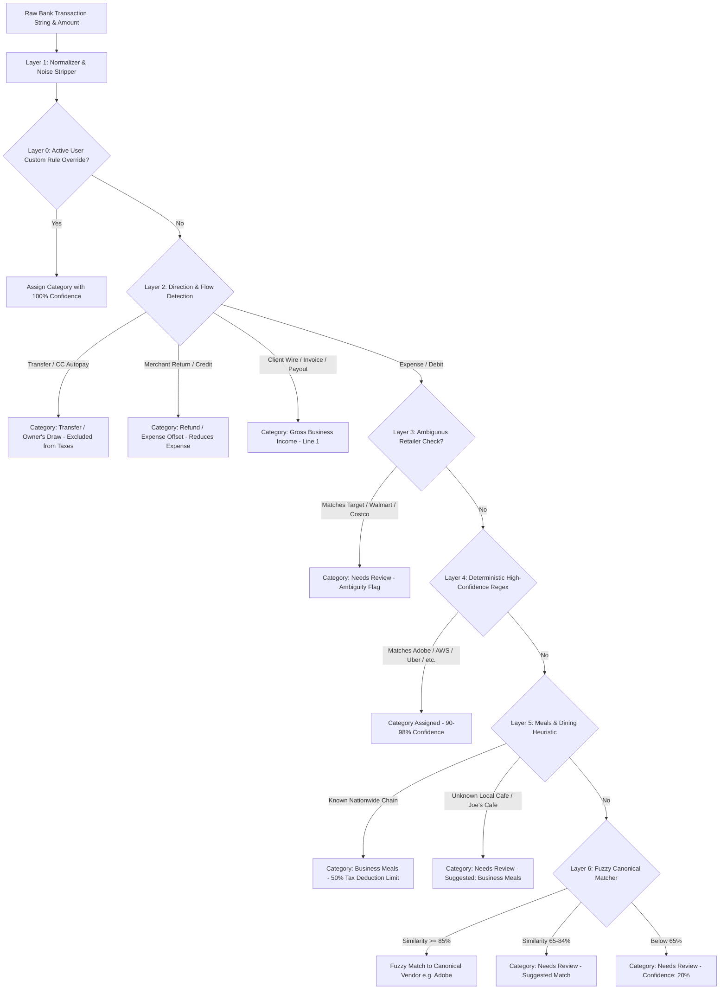

# Architecture & Design Document: TaxBrain Statement Categorizer

## 1. Executive Summary & Customer Use Case

### Target Persona: Freelance Creative & Tech Consultant (Sole Proprietor — IRS Schedule C)
Freelancers and solo contractors operate businesses where business expenses and personal transactions frequently mix on credit cards and bank statements. At tax time, they must categorize every line item to fill out **IRS Form 1040 Schedule C (Profit or Loss From Business)**.

### Why This Customer?
Freelancers face unique tax accounting pain points that standard personal finance tools fail to address:
1. **High SaaS & Cloud Infrastructure Volume**: Modern freelancers subscribe to 10+ digital services (Adobe Creative Cloud, Figma, GitHub, AWS, OpenAI API, Zoom).
2. **The 50% Business Meals Tax Trap**: Unlike general expenses which are 100% deductible, the IRS strictly limits business meals (coffee with clients, business dinners) to a **50% deduction limit** (IRC § 274(n)).
3. **Refunds vs. Income Confusion**: When Amazon or an airline refunds money to a business card, accounting systems often misclassify the positive credit as *taxable income*. Under tax law, a refund is a **reduction of an expense**, not revenue.
4. **Non-Expense Transfers**: Credit card autopayments (`AUTOPAY PAYMENT - THANK YOU`) and transfers to personal accounts (`ZELLE TO OWNER DRAW`) are equity balance sheet movements, **not** tax-deductible expenses.
5. **Ambiguous Local Merchants**: Transactions like `JOES CAFE 9921` could be a deductible client strategy meeting or a personal coffee. Guessing blindly triggers IRS audit risk. **A wrong guess is worse than asking.**

---

## 2. The Core Rule: Why Zero Big AI Models in "The Brain"?

`TASK.md` mandates:
> *"The brain must be your own code. Do not use a big AI model (like GPT, Claude or Gemini) to decide a category. Your code decides what each transaction is and when it is not sure."*

### Why Deterministic Algorithmic Classification is Superior for Tax Preparation:
- **Zero Hallucinations**: Financial and tax preparation systems cannot tolerate stochastic non-deterministic outputs. A regex or dictionary rule either matches or routes to review with 100% predictability.
- **Auditability & Explainability**: Every categorization in TaxBrain provides an explicit `reason` string and `confidence` score (e.g., *"Recognized design & prototyping subscription (Figma)"* or *"Local dining/cafe venue detected. Requires confirmation of business client purpose"*).
- **Latency & Cost**: Pattern matching runs locally in microseconds (over 1,000 transactions per second) without API keys, per-token billing, rate limits, or network timeouts.
- **Data Privacy & Compliance**: Financial statement data (account numbers, names, balances) never leaves the user's local infrastructure.

---

## 3. The 7-Layer Brain Architecture

Every transaction row passes through a sequential 7-layer pipeline:

### Layer 1: Normalization & Noise Stripping (`normalizer.py`)
Bank statement descriptions are heavily polluted with metadata. The normalizer systematically cleans strings:
- **Prefixes**: Strips `POS DEBIT`, `PURCHASE AUTHORIZED ON MM/DD`, `SQ *`, `TST*`, `PAYPAL *`, `STRIPE *`, `CHECKCARD`.
- **Card Masks**: Strips `CARD 1234`, `XXXX-1234`, `*9921`, `#4829`.
- **Phone Numbers**: Strips `800-833-6687`, `(415) 555-0192`.
- **Locations & Terminals**: Strips US postal state abbreviations, zip codes, international country codes (`IRL`, `GBR`), and store numbers (`STORE #0382`, `TERM 12`).
- **Flags**: Detects signals for refunds, transfers, and incoming client payouts before stripping.

### Layer 0: User Custom Rule Override (`categorizer.py`)
If a user corrects an uncertain row in the UI and checks *"Remember rule for this merchant"*, the Brain stores that mapping in its session registry. Future occurrences automatically receive **1.0 confidence** with the reason *"Applied user custom rule"*.

### Layer 2: Direction & Cash-Flow Analysis
- **Transfers & Autopay**: Descriptions containing `AUTOPAY PAYMENT - THANK YOU`, `TRANSFER TO SAVINGS`, or `ZELLE TRANSFER TO OWNER PERSONAL DRAW` are categorized as `Transfer / Owner's Draw (Non-Expense)`. They are excluded from business expense totals.
- **Refunds & Returns**: Credits with `REFUND`, `REVERSAL`, or `RETURN` from retail vendors are assigned `Refund / Expense Offset`. They reduce deductible expenses rather than inflating taxable income.
- **Gross Income**: Positive credits containing `CLIENT ACH DEPOSIT`, `INVOICE #109`, or `STRIPE PAYOUT` are routed to `Gross Business Income` (Schedule C Line 1).

### Layer 3: Ambiguous Retailer Guardrails
Multi-department retailers (`Target`, `Walmart`, `Costco`, `Dollar Tree`, `Amazon` without digital services marker) sell mixed personal groceries and office supplies. The Brain intentionally routes them to **Needs Review** with a 0.50 confidence score.

### Layer 4: Deterministic High-Confidence Regex Matching (`rules.py`)
Pattern matching against curated vendor taxonomies:
- **Software & SaaS (100% Deductible)**: `Adobe`, `Figma`, `GitHub`, `GitLab`, `JetBrains`, `AWS`, `Google Workspace`, `Zoom`, `Slack`, `Notion`, `Linear`, `OpenAI`, `Anthropic`.
- **Travel & Transit (100% Deductible)**: `Uber`, `Lyft`, `Delta Air`, `United Airlines`, `Airbnb`, `Marriott`, `Amtrak`.
- **Equipment & Hardware (<$2,500 Safe Harbor)**: `Apple Store`, `B&H Photo`, `Dell`, `Keychron`.
- **Advertising & Marketing (100% Deductible)**: `Google Ads`, `Meta Ads`, `LinkedIn Ads`, `Namecheap`, `GoDaddy`.
- **Professional Services (100% Deductible)**: `Upwork`, `Fiverr`, `LegalZoom`, `QuickBooks`, `Gusto`.
- **Banking Fees (100% Deductible)**: `Monthly Service Fee`, `Wire Transfer Fee`, `Foreign Transaction Fee`.

### Layer 5: Meals & Dining Heuristics (50% Statutory Limit)
- **Known National Chains**: (`Starbucks`, `Blue Bottle`, `DoorDash`, `Sweetgreen`) are categorized as `Business Meals & Dining` with `deductibility_pct = 0.50`.
- **Local / Unknown Venues**: (`JOES CAFE 9921`, `CORNER BISTRO`) match dining keywords but lack corporate identity. To satisfy the mandate *"A wrong guess is worse than asking"*, they are routed to **Needs Review** with `suggested_category = "Business Meals & Dining"` and note: *"Requires confirmation of business client purpose (50% deduction)"*.

### Layer 6: Fuzzy Canonical Matcher
Uses normalized token sequence similarity (`difflib.SequenceMatcher`):
- If similarity $\ge 0.85$ (e.g. `ADOB CREATV CLD` $\rightarrow$ `ADOBE`): categorized with confidence 0.88.
- If similarity is $0.65 - 0.84$: routed to **Needs Review** with a suggested category for human verification.

### Layer 7: Safety Shield Fallback
Any transaction that passes through all layers without a confident match defaults to **Needs Review** (Confidence: 0.20).

---

## 4. IRS Schedule C Tax Calculation Engine

The tax summary calculation strictly implements federal tax rules:

$$\text{Gross Business Income} = \sum \text{Client Receipts}$$

$$\text{Total Deductible Expenses} = \sum (\text{Expense Amount} \times \text{Deductibility \%})$$
$$\text{Where: } \text{Deductibility \%} = \begin{cases} 0.50 & \text{for Business Meals} \\ 1.00 & \text{for Software, Office, Travel, Equipment, Ads, Legal, Fees} \end{cases}$$

$$\text{Net Taxable Profit} = \text{Gross Business Income} - (\text{Total Deductible Expenses} - \text{Refunds Offset})$$

---

## 5. Summary Table: Edge Cases Handled

| Real-World Edge Case | Common Financial Software Mistake | TaxBrain Handling |
| :--- | :--- | :--- |
| **`AMZN MKTPLACE REFUND`** | Counted as taxable business revenue. | Categorized as **Refund / Expense Offset**; reduces expenses. |
| **`AUTOPAY PAYMENT - THANK YOU`** | Double-counted as business spending. | Categorized as **Transfer / Owner's Draw**; excluded from deductions. |
| **`JOES CAFE 9921`** | Wrongly classified as 100% travel or office. | Routed to **Needs Review**; suggests Business Meals (50%). |
| **`STARBUCKS STORE 08412`** | Deducted at 100%. | Classified as **Business Meals & Dining** with statutory **50% limit**. |
| **`TARGET` or `WALMART`** | Automatically deducted as office supplies. | Routed to **Needs Review** due to personal grocery overlap. |
| **`ADOB CREATV CLD 800-833`** | Marked as unclassified due to statement noise. | Normalizer strips phone number; fuzzy matcher matches **Adobe** SaaS. |
