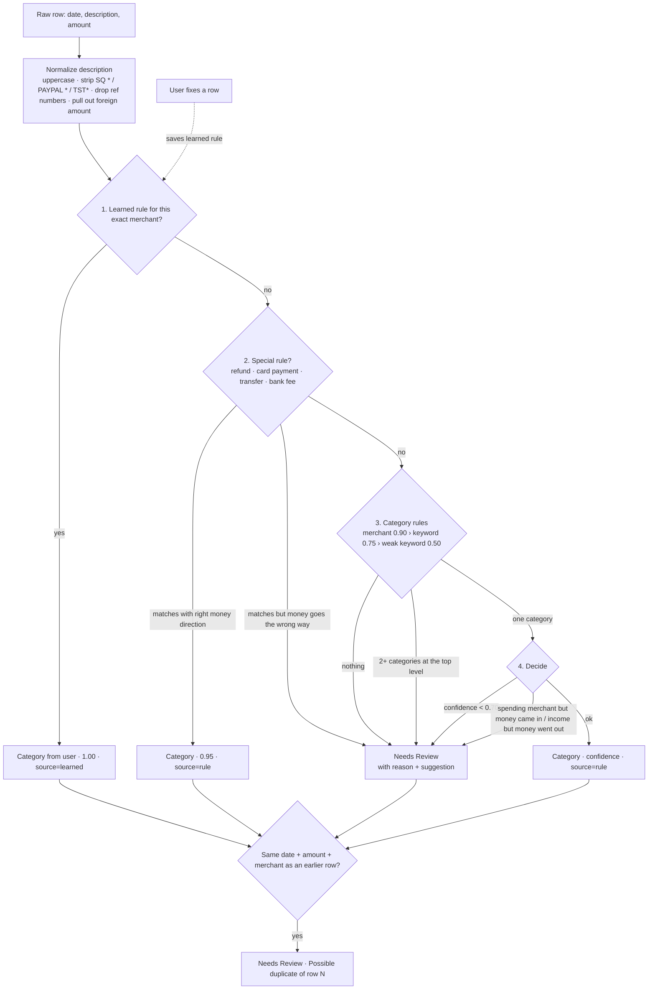

# DESIGN — LedgerLite

## 1. Use case

**Sara Khan** (fake user) is a freelance designer. She pays for work things — Adobe, Figma,
flights to client workshops, a Wacom tablet, ads for her portfolio — on one business credit
card, and some personal things slip onto it too. At tax time she needs every transaction
in a category, totals per category, and confidence that money that *isn't* spending
(moving cash to savings, paying the card bill) and money that came *back* (refunds) is not
counted as expenses or income.

LedgerLite does that job end to end:

1. Upload the card's CSV export (any of several bank layouts).
2. Every row gets a category, a confidence and a plain-English reason.
3. Rows the app is not sure about go to **Needs Review** — it never guesses.
4. Sara fixes those rows from a dropdown; the app **remembers** the fix for that merchant.
5. She sees totals per category (refunds reduce spending, transfers and card payments are
   kept apart) and exports the categorized statement as CSV for her accountant.

> A wrong guess is worse than asking. Every design choice below follows from that.

## 2. Architecture

```
frontend (Next.js)  ──HTTP/JSON──▶  FastAPI routes  ──▶  services  ──▶  SQLite (SQLModel)
                                                          │
                                       ┌──────────────────┴─────────────────┐
                                       ▼                                    ▼
                         parsing/csv_parser.py                   engine/  (the brain)
                         tolerant CSV reader                     pure Python, no I/O
```

- `backend/app/engine/` is **pure Python**: no FastAPI, no database, no network, no LLM.
  It takes a description + amount (+ the user's learned rules) and returns a decision.
  That keeps it fast, deterministic and easy to test (100% line coverage).
- Rules live in `engine/rules.yaml`, not in code. Adding a merchant is a one-line YAML change.
  The loader validates every category name, so a typo fails loudly at start-up.
- `services.py` is the only place that combines parser + brain + database. Routes stay thin.
- The API contract is written down in [`docs/api-contract.md`](docs/api-contract.md).

## 3. How the brain decides



**Step 1 — Learned rules (1.00).** When Sara changes a category, the normalized merchant
(`JOES CAFE`) becomes a learned rule. It is matched by *exact* normalized merchant, so
`SQ *JOES CAFE` and `JOES CAFE 9921` both hit it, but `AMAZON REFUND` is never captured by
a learned `AMAZON` rule. Learned rules run *before* special rules on purpose: the user's
explicit decision about this exact merchant is the strongest evidence we have. (The first
plan had them second; we moved them up so a fix like "this `ZELLE TRANSFER TO ALI` is
Personal" actually sticks.) Fixing a row also applies the rule to the other rows of the same
merchant in that statement.

**Step 2 — Special rules (0.95).** Money-movement cases that must never be mistaken for
spending or income, each with a required direction of money:

| Rule | Example | Direction | Category |
| --- | --- | --- | --- |
| refund | `AMAZON REFUND`, `LATE FEE REVERSAL` | money in | Refund |
| card payment | `PAYMENT THANK YOU`, `AUTOPAY` | money in | Card Payment (not spending) |
| transfer | `TRANSFER TO SAVINGS` | either | Transfer (not spending) |
| bank fees | `ANNUAL FEE`, `FX FEE`, `INTEREST CHARGE` | money out | Bank Fees |

If the wording matches but the money goes the wrong way (`REFUND PROCESSING FEE -5.00`),
that is a contradiction, so the row goes to Needs Review with the reason spelled out.

**Step 3 — Category rules.** Patterns from `rules.yaml` are matched as *whole words* on the
normalized merchant (`ADS` matches `META ADS`, not `ROADSIDE`). Three strengths:

| Level | Confidence | Example |
| --- | --- | --- |
| known merchant | 0.90 | `ADOBE` → Software & Subscriptions |
| keyword | 0.75 | `…AIRLINES…`, `HOTEL` → Travel |
| weak keyword | 0.50 | `CAFE`, `STORE` — a hint, never enough alone |

Only the strongest level that matched counts. A more specific merchant beats a shorter one
it contains (`UBER EATS` → Meals beats `UBER` → Travel). If two *different* categories match
at the top level — `AMAZON` is listed under both Office Supplies and Personal on purpose —
it is a tie and goes to Needs Review with reason `Multiple matches: …`.

**Step 4 — Decide.** A category is assigned only when exactly one category wins **and**
confidence ≥ **0.70**, and the money direction makes sense (a spending merchant with money
coming in and no refund wording could be a refund, a chargeback or a mistake → review).

**Duplicates** run after classification over the whole statement: same date, same amount
and same normalized merchant → the later copy is flagged *Possible duplicate of row N* and
sent to Needs Review, so it is never double-counted in totals.

**Every result carries four things:** `category`, `confidence`, `reason` (e.g.
`Merchant 'ADOBE' matched Software & Subscriptions`) and `source` (`rule` / `learned` /
`user` / `none`). The UI shows the reason under every row — the brain is never a black box.

### Why 0.70?

The threshold sits deliberately *between* "keyword" (0.75) and "weak keyword" (0.50):

- A known merchant or a clear keyword (`AIRLINES`, `HOTEL`) is trusted.
- A weak hint alone (`JOES CAFE` — is it a client lunch or a personal coffee?) is not.
- Ties are divided by the number of candidates (0.90 / 2 = 0.45), so they always fall below.

So the threshold is not a tuned magic number; it encodes the rule "trust names and clear
keywords, never hints". It lives in `rules.yaml` and can be raised for a stricter user.

## 4. Messy cases and how each is handled

Each has a fake row in `sample_data/` and at least one test.

| Case | Example | What the app does | Test |
| --- | --- | --- | --- |
| Refund | `AMAZON REFUND +30.00` | **Refund**; reduces net spending, never income | `test_refund_is_refund_not_income`, `test_summary_totals` |
| Own transfer | `TRANSFER TO SAVINGS -500` | **Transfer (not spending)**, outside spending totals | `test_transfer_to_savings_is_not_spending` |
| Card bill payment | `PAYMENT THANK YOU +800` | **Card Payment (not spending)** | `test_card_payment` |
| Unknown merchant | `JOES CAFE 9921`, `BLUE DOOR STUDIO` | Needs Review (with weak hint "Meals" where one exists) | `test_unknown_merchant_needs_review`, `test_joes_cafe_needs_review_with_weak_hint` |
| Two categories collide | `AMAZON` (office or personal?) | Needs Review, `Multiple matches: …` | `test_two_categories_tie_needs_review` |
| Positive amount, no refund word | `UNKNOWN CREDIT +15.00`, `ADOBE +25.00` | Needs Review — no guessing income or refund | `test_positive_unknown_amount_is_not_guessed`, `test_money_in_from_spending_merchant…` |
| Contradictory wording | `REFUND PROCESSING FEE -5.00` | Needs Review, "money went out" | `test_refund_wording_with_money_going_out_needs_review` |
| Duplicate row | `STAPLES 00231 -48.20` twice | 2nd row: Possible duplicate + Needs Review | `test_duplicate_second_row_is_flagged` |
| Mixed date formats | `03/05/2026`, `2026-05-03`, `3 May 2026` | All → 2026-05-03. Day/month order inferred from the whole file (a `13/05` proves day-first); ISO never flipped | `test_messy_three_date_formats_are_the_same_day`, `test_iso_dates_are_never_flipped_by_day_first` |
| Ambiguous dates | only `03/05`-style dates in a file | Read as month/day, file warning + per-row note | `test_ambiguous_dates_produce_warning_and_note` |
| Debit / Credit columns | `Debit=54.99, Credit=` | One signed amount (credit − debit) | `test_bank_b_debit_credit_columns_become_signed_amount` |
| Amount formats | `"1,250.00"`, `$54.99`, `(54.99)`, `54.99-`, `54.99 CR` | Clean signed number; brackets = negative | `test_parse_amount` |
| Broken row | empty amount, `not a date`, `abc`, `Total` line | Row skipped, warning `Row 14 skipped: …` | `test_messy_file_preamble_skipped_rows_and_warnings` |
| Preamble / BOM / `;` delimiter / cp1252 | bank name lines before header | Header row auto-detected, encodings handled | `test_semicolon_delimiter_and_bom`, `test_cp1252_encoding` |
| Different column names | `Txn Date`, `Details`, `Amount (USD)` | Alias table | `test_column_aliases` |
| Bank fees | `ANNUAL FEE`, `LATE FEE`, `FX FEE` | **Bank Fees** | `test_bank_fees` |
| Fee reversal | `LATE FEE REVERSAL +25` | **Refund** (refund rule runs first) | `test_fee_reversal_is_a_refund` |
| Foreign currency | `HOTEL LISBOA EUR 120.00` | Category as normal + note "original charge 120.00 EUR" | `test_foreign_currency_keeps_category_and_adds_note` |
| Processor prefixes | `SQ *JOES CAFE`, `PAYPAL *ADOBE`, `TST*` | Prefix stripped before matching | `test_normalize_merchant` |
| Empty / wrong file | `.pdf`, 0 bytes, header only, binary, > 5 MB | Clear 400 message, no crash | `test_bad_uploads_give_clear_400`, `test_upload_too_large` |

## 5. Totals

- **Spending** = money out in spending categories (Software, Travel, Meals, Office, Internet &
  Phone, Advertising, Bank Fees, Personal).
- **Net spending** = spending − refunds. A refund is money back, not income.
- **Not spending** (transfers, card payments) is reported separately as volume moved.
- **Income** is its own line.
- Needs Review rows count in no category until fixed — an unsure row never silently
  inflates a tax category.

## 6. What we did not build (yet) and why

| Not built | Why | Next step |
| --- | --- | --- |
| PDF statements | PDF table extraction is a project of its own and error-prone; CSV export exists for every major card | Add `pdfplumber` parser behind the same `RawTransaction` interface |
| Currency conversion | Card statements are already settled in home currency; converting again would be wrong | Keep the original foreign amount (done, as a note); add per-currency reporting |
| Card-specific sign detection | Some issuers export charges as *positive* numbers | Detect from card-payment rows' sign and flip the file with a warning |
| Auth / multi-user | Single fake user for the assessment | Learned rules are already a table — scope by `user_id` |
| Fuzzy merchant matching | Exact/whole-word matching is explainable and predictable | Token similarity as an extra *weak* level, still below threshold |
| Split transactions | e.g. one Amazon order, half office / half personal | Allow a row to have N category lines summing to the amount |
