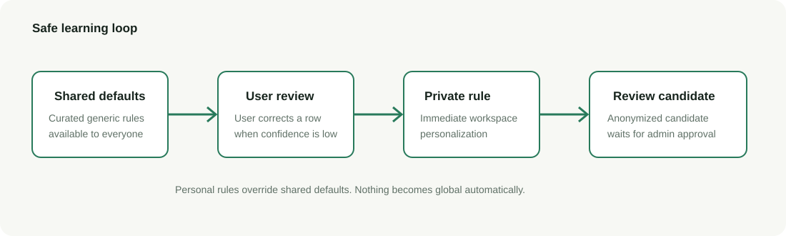
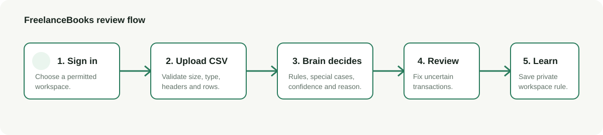
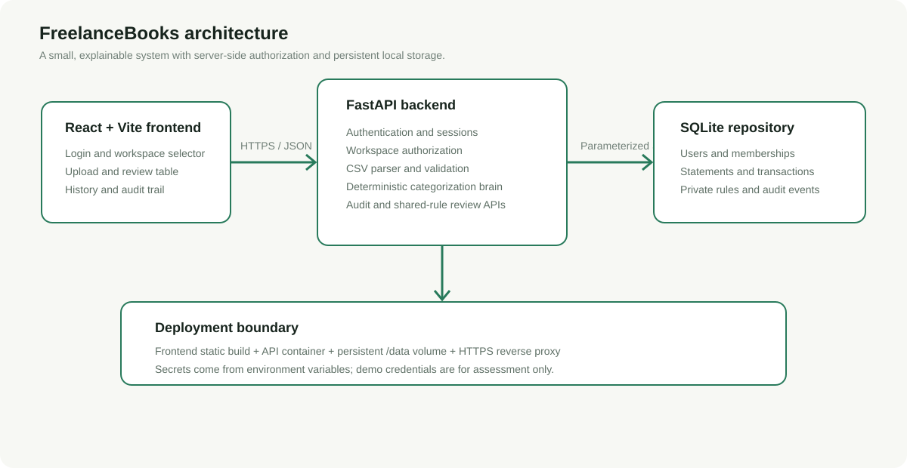

# FreelanceBooks design



## 1. Product and user

FreelanceBooks is designed for freelancers with foreign clients who need a first-pass organization of business and mixed-use transactions before tax preparation. It is intentionally a review assistant, not a tax advisor.

The primary user journey is:

1. Sign in to a workspace.
2. Upload a CSV statement.
3. Parse and normalize every row.
4. Categorize each transaction.
5. Review low-confidence rows.
6. Correct mistakes.
7. Reuse private corrections on future statements.

## 2. Categories

Freelancer categories include Client Income, Software, Advertising & Marketing, Internet & Phone, Equipment, Payment Processing Fees, Travel & Transport, Meals, Office Expenses, Taxes, Transfer, Refund, Personal Expense, and Needs Review.

The importer also supports general expense data with Food & Dining, Transport, Travel, Shopping, Utilities, Health, Entertainment, Education, Personal Care, Electronics, and Other. These categories make the provided assessment dataset useful without pretending it is a freelancer bank statement.

## 3. Decision brain

The application does not call GPT, Claude, Gemini, or another large model to make category decisions. The brain is ordinary, auditable Python code.

### Processing order

1. **Normalize**: uppercase descriptions, remove punctuation noise, and combine merchant/details fields.
2. **Detect special cases**: refunds/reversals, transfers, cash withdrawals, and likely client income.
3. **Match personal rules**: exact personal rules first, then personal patterns.
4. **Match shared defaults**: curated merchant patterns.
5. **Match generic keywords**: weaker evidence that remains reviewable.
6. **Needs Review**: no reliable match is never converted into a confident guess.

### Priority

```text
special-case safety rules
    > user exact rule
    > user pattern rule
    > shared merchant rule
    > generic keyword rule
    > Needs Review
```

Personal rules override shared rules. Every result includes a category, confidence score, explanation, review flag, and optional rule source.

## 4. Learning model



When a user changes a row, FreelanceBooks immediately saves a private rule scoped to that workspace. That rule is used on future uploads in the same workspace.

The system does not automatically publish corrections globally. It creates a separate pending shared-rule candidate only when the merchant pattern is sufficiently generic. An administrator can review candidates later. This prevents a personal client name or an incorrect correction from becoming a shared rule.

## 5. Data and security model



- SQLite stores persistent application data.
- Passwords are stored as PBKDF2-SHA256 hashes with random salts.
- Sessions are signed and expire after 24 hours.
- Workspace membership is checked on the server for every protected request.
- The client-selected workspace header is never treated as proof of identity.
- Uploads are restricted to CSV and 10 MB.
- SQL uses parameters rather than string interpolation for values.
- Sensitive API responses include basic browser security headers.
- Shared-rule candidates require administrator authorization.

The seeded demo accounts are for assessment convenience. A public deployment needs managed identity, password reset, MFA, secret rotation, HTTPS, protected backups, and stronger operational controls.

## 6. Persistence

The database contains:

- `users`
- `workspaces`
- `workspace_members`
- `statements`
- `transactions`
- `rules`
- `audit_events`
- `shared_rule_candidates`

The audit trail records the workspace, statement, transaction, old category, new category, and timestamp. The current repository is intentionally small and local; a larger deployment can move the same schema to PostgreSQL.

## 7. Trade-offs and next improvements

The assessment favors an explainable local product over a large infrastructure footprint. SQLite makes the project easy to run and review. For production scale, the next improvements are PostgreSQL, object storage for original files, background processing for large statements, rate limiting, CSRF-safe cookie sessions, an admin review UI, and managed authentication.
