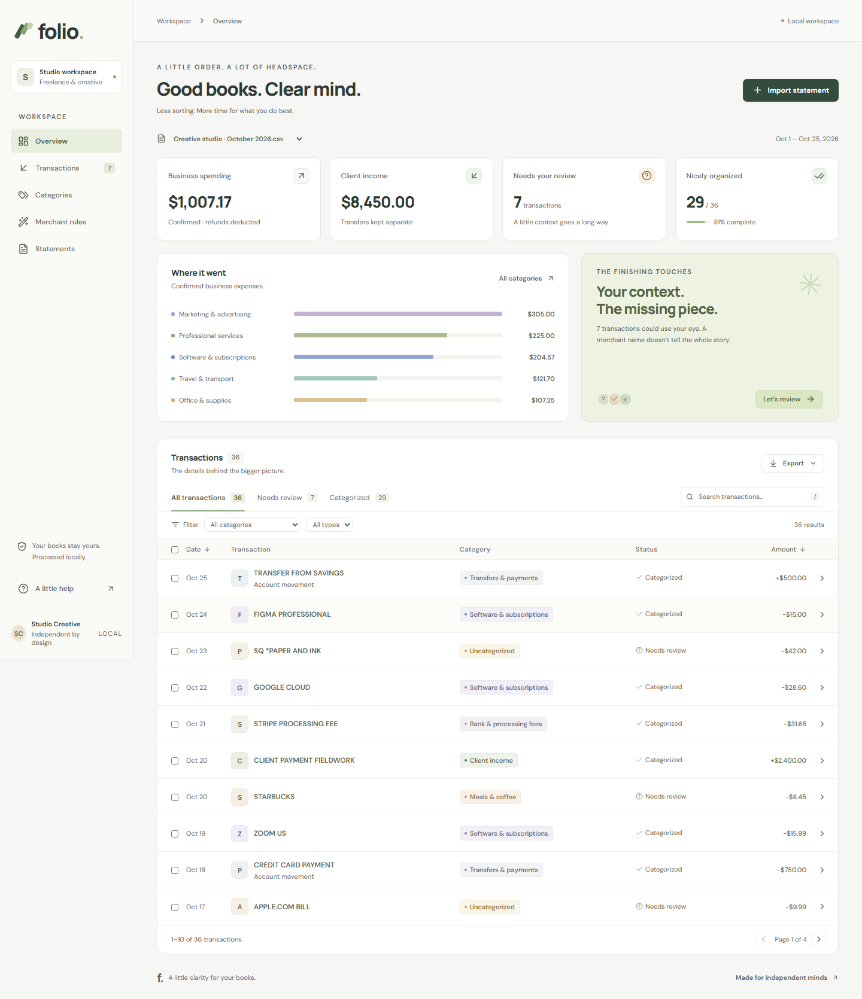

# Folio

A little clarity for your books. An interactive statement categorizer for independent designers and creative freelancers.

**Python + React. Original decision engine. Local processing.**



## Quick start

Requirements: **Python 3.11–3.13** and **Node.js 22.12+**. No API keys, model downloads, accounts, or external services.

From the repository root, on Windows PowerShell:

```powershell
python -m venv .venv
.venv/Scripts/python -m pip install -r backend/requirements.lock -e './backend[test]'
npm --prefix frontend ci
python scripts/dev.py
```

On macOS / Linux:

```bash
python3 -m venv .venv
.venv/bin/python -m pip install -r backend/requirements.lock -e './backend[test]'
npm --prefix frontend ci
python3 scripts/dev.py
```

Open **http://127.0.0.1:5173**. Choose **Try a sample statement** for the complete experience using 36 fictional transactions. Ctrl+C stops both services. No real statements are included.

On Windows, the combined runner keeps Python reload off because its console signal can also stop npm; restart after Python edits. Frontend hot reload remains enabled. Separate terminals below can be used for independent backend reload.

To start services separately, run these in two terminals from the repository root (use `.venv/bin/python` on macOS / Linux):

```powershell
.venv/Scripts/python -m uvicorn app.main:app --app-dir backend --reload --host 127.0.0.1 --port 8000
npm --prefix frontend run dev
```

## What you can do

- Import CSV or text-based PDF statements. Choose currency, date order, and amount signs explicitly.
- Search, sort, filter, paginate, and explore category totals.
- Open a transaction to inspect its evidence, correct the category, add context, and see its history.
- Work through **Confirm & next**, or categorize a selection together.
- Remember an exact merchant and money direction for future imports; inspect and remove those rules.
- Review possible duplicates individually, keeping or excluding each from totals.
- Export all rows, ready rows, or a category summary. Pending status and exclusions remain explicit.
- Remove a statement from the library to import it again with different settings.

The headline totals use included rows that **do not need review**. Recognized merchants, explicit money movements, your rules, and manual confirmations can all qualify. Unresolved amounts are kept out of those totals. Refunds reduce expenses; transfers and personal spending stay separate. This organizes bookkeeping categories, rather than deciding legal tax deductibility.

## Supported statements

CSV: UTF-8/BOM, BOM-marked UTF-16, or Windows-1252; comma, semicolon, or tab separators. A header can follow up to 24 preamble rows. Transaction date takes priority over posting date; Description takes priority over Details/Memo. Identical duplicate headers remain errors. Supported aliases are listed in [`parser.py`](backend/app/parser.py).

```csv
Date,Description,Amount,Currency
2026-10-01,ADOBE CREATIVE CLOUD,-59.99,USD
2026-10-02,ADOBE REFUND,10.00,USD
2026-10-03,TRANSFER TO SAVINGS,-200.00,USD
```

Alternatively use `Date,Description,Debit,Credit` with positive values in the appropriate column. Blank means absent; zero remains a real transaction.

Money accepts one optional currency prefix, one sign, valid grouping, up to two decimal places, accounting parentheses, and explicit CR/DR direction. Embedded or repeated currency symbols, contradictory signs, and mixed metadata currencies are rejected instead of repaired. For example, `$12.34` is valid for USD; `1$2.34` and `$$12.34` are errors.

| Setting | Behavior |
| --- | --- |
| Bank account | Negative signed amounts are money out; positive amounts are money in. |
| Credit card | Positive numeric charges become money out; negative numeric credits become money in. |
| Card CSV versus PDF | Choose by the actual signs. A card CSV can already have negative expenses even when its PDF uses positive charges. Explicit Sale/Return type conflicts are rejected. |
| Explicit `CR` / `DR` | Credit means money in and debit means money out, overriding the numeric convention. |
| Separate Debit / Credit | Positive debit is money out; positive credit is money in. |
| Dates | ISO `YYYY-MM-DD` always works. Numeric slash/dash dates follow the selected MDY or DMY order, with four-digit years. |
| PDF dates without years | Recognized text tables can use a full printed statement period. For a short-year period, set **Statement year** under **Format details**; no current-year guess is made. |
| Decimal separator | Choose period (`1,234.56`) or comma (`1.234,56`). Grouping and precision are validated. |
| Currency | USD, GBP, EUR, CAD, AUD, PKR; exactly one per statement. No exchange-rate conversion. |

PDF: selectable text with recognizable ruled transaction tables, plus bounded borderless profiles for Date/Description/Withdrawals/Deposits/Balance, Activity/Date/Amount/Balance, and card transaction-description/amount tables. Repeated page headers are supported. Running balances, opening/closing balances and declared totals are checked when available. A conservative fallback supports full ISO-date transaction lines ending in a signed two-decimal amount. **Not a universal bank-layout parser.** Scans, encrypted files, unsupported wrapping, malformed transaction rows, and unknown layouts return actionable errors. Missing reconciliation or unsupported nontransaction pages produce visible warnings and force imported rows into review. Check PDF results against the original.

Limits: 10 MB, 40 PDF pages, 10,000 transactions per import. Invalid CSV rows abort the entire import and identify the problem rows. Identical files cannot be imported twice; overlapping files flag matching transactions for review rather than deleting them.

See [`samples/`](samples) for signed-amount and debit/credit fixtures. The GBP example uses **day / month / year**.

## Verify

```powershell
.venv/Scripts/python -m pytest backend/tests -q
npm --prefix frontend run build
cd frontend
npx playwright install chromium
npm run test:e2e
```

The browser suite starts both servers using a fresh temporary database, exercises the actual Python API, and checks desktop/mobile layouts and accessibility with axe. Ports **8001 and 4173 must be free**; your normal app can keep running on 8000/5173. Tests run serially as a complete workflow; later browser cases build on earlier review actions. Screenshots and failure traces go to ignored `frontend/test-results/`.

CI runs the backend on Windows and Linux with Python 3.11 and 3.13, plus a Chromium browser workflow on Linux. Dependency versions are recorded in `backend/requirements.lock` and `frontend/package-lock.json`.

## Built frontend, one server

```powershell
npm --prefix frontend run build
.venv/Scripts/python -m uvicorn app.main:app --app-dir backend --host 127.0.0.1 --port 8000
```

Open **http://127.0.0.1:8000**. FastAPI serves the built React app and API together. API documentation: **http://127.0.0.1:8000/docs**. Rebuild and restart after frontend changes.

## Data and boundaries

SQLite stores parsed transactions, merchant rules, and review history in ignored `data/folio.db`. Set `FOLIO_DB` to use another database path. Original uploaded files are not retained. Fonts and application assets are bundled locally; no transaction content is sent to a remote classifier or analytics provider.

Automatic refund matches reserve the earlier purchase's remaining amount. Backdated imports cannot reuse that reservation. Removing, excluding, or changing the category of the supporting purchase returns an unsupported automatic refund to review and records the change in its history. Startup migrations revalidate older matches; ambiguous old merchant rules remain visible for confirmation. Explicit human decisions remain authoritative.

This is a **single-user local application**. Bind to loopback and use it on a trusted device. Authentication, tenant isolation, encrypted backups, and hardened PDF processing would be required before exposing it as a hosted service. The API rejects untrusted Host headers and cross-origin mutations, validates financial input, uses SQL parameters and transactional writes, detects stale reviews, and escapes spreadsheet formulas in free-text export fields.

## Project map

```text
backend/app/engine.py      Original decision engine, evidence and refund reconciliation
backend/app/refunds.py     Refund allocations, dependency checks and identity migration
backend/app/parser.py      CSV/PDF ingestion and money/date validation
backend/app/storage.py     SQLite schema and connection lifetime
backend/app/main.py        API, atomic imports/reviews, summaries and exports
backend/tests/             Decision, parser, API and usage-export regression tests
frontend/src/              React workspace, accessible dialogs, styles and API types
frontend/e2e/              Real browser workflow and accessibility checks
samples/                   Fictional statements only
scripts/                   Cross-platform runner and sanitized AI usage exporter
```

Read [`DESIGN.md`](DESIGN.md) for the engine and tradeoffs, [`AI_USAGE.md`](AI_USAGE.md) for how AI assisted development, and [`TASK.md`](TASK.md) for the original assessment.

See [`docs/EXTERNAL_VALIDATION.md`](docs/EXTERNAL_VALIDATION.md) for tests against independently published statement samples: five exact imports, financial reconciliation, before/after evidence, and candid category-coverage results. Original external statements are kept outside the repository.

See [`docs/REVIEW_FIXES.md`](docs/REVIEW_FIXES.md) for the eight review findings, related edge cases, and their regression coverage.

The original fork/branch/submission guide is retained at [`docs/SUBMISSION_GUIDE.md`](docs/SUBMISSION_GUIDE.md). Work is on `candidate-Wyrmstooth`, targeting `savvpro/savvpro-test-statement-categorizer:main`.
