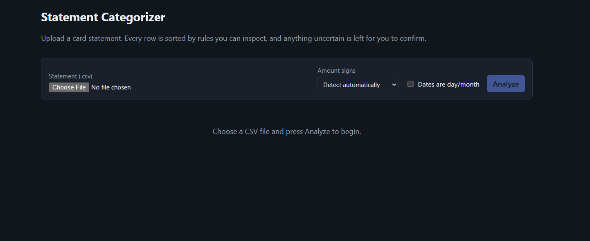
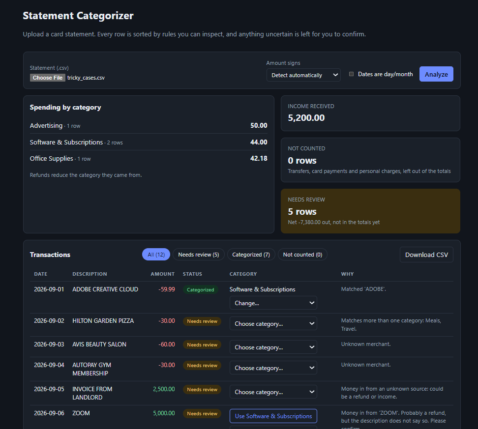

# Statement Categorizer

Upload a business credit card statement (CSV) and get every transaction sorted into a tax category, with a total per category. If the app is not sure about a row, it says so and asks you instead of guessing.

**Use case:** a freelancer or small business owner who needs their business card statement sorted at tax time.

The part that decides categories is plain Python rules in `backend/app/`. No AI model is used at runtime and there are no API keys. See [DESIGN.md](DESIGN.md) for how it decides and [AI_USAGE.md](AI_USAGE.md) for how AI tools were used to build it.

## Screenshots





## What you can do in the app

- Upload a `.csv` statement (up to 5 MB).
- See every row with its category and whether it was categorized, excluded or needs review (filterable).
- See totals per category, income, and how many rows are excluded or waiting for review.
- Fix rows in **Needs Review**: accept the suggestion or pick a category. You can also **change any row**, including ones the app was confident about, mark a charge as **Personal** (left out of the totals), or **Undo** a change. Changes apply to the file you are looking at and are not stored.
- Confirm that a flagged possible duplicate is a real charge.
- Download the result as a CSV (all rows, with status, category, suggestion and the reason for each decision).
- Choose how to read the file if it guesses wrong: sign convention (which amounts are expenses) and day-first dates.

## Requirements

- Python 3.10 or newer
- Node.js 22 or newer (CI and Docker use Node 24)
- Optional: Docker, to run everything with one command

## Run it

### Option A: Docker

```bash
docker compose up --build
```

Open http://localhost:8080. The frontend container proxies `/api` to the backend container.

### Option B: two terminals

You need one terminal for the backend and one for the frontend.

**Backend** (Windows PowerShell):

```powershell
cd backend
python -m venv .venv
.\.venv\Scripts\Activate.ps1
pip install -r requirements.txt
uvicorn app.main:app --reload
```

**Backend** (macOS / Linux):

```bash
cd backend
python3 -m venv .venv
source .venv/bin/activate
pip install -r requirements.txt
uvicorn app.main:app --reload
```

The API runs at http://127.0.0.1:8000. Check http://127.0.0.1:8000/api/health, it should return `{"status":"ok"}`. Interactive API docs are at http://127.0.0.1:8000/docs.

**Frontend:**

```bash
cd frontend
npm install
npm run dev
```

Open http://localhost:5173. The dev server proxies `/api` to the backend on port 8000, so start the backend first.

### Try it

Upload `sample_data/freelancer_card.csv` (a fake statement). It has 17 rows: 8 are categorized, 2 are excluded (a transfer and a card payment), and 7 need review (a cafe, a coffee shop, a restaurant, Uber Eats, an Amazon purchase, an Amazon credit and a possible duplicate GitHub charge).

`sample_data/tricky_cases.csv` has 12 rows made to trip the rules: a known word inside another business, money in that is not a refund, and a name stuck to a long number. 7 are categorized and 5 need review.

## Run the tests

From the `backend/` folder with the virtual environment active:

```bash
pip install -r requirements-dev.txt
python -m pytest
```

Frontend checks, from `frontend/`:

```bash
npm run lint
npm run build
```

GitHub Actions (`.github/workflows/ci.yml`) runs the backend tests, the frontend lint and build, and a Docker build on every push to `main` and on pull requests.

## Configuration

One optional environment variable for the backend.

| Variable | Default | What it does |
|---|---|---|
| `CORS_ORIGINS` | `http://localhost:5173,http://127.0.0.1:5173` | Comma-separated list of frontend origins allowed to call the API. |

Nothing is stored. Uploaded statements are processed in memory and your fixes live only in the browser page, so there is no database and no data folder.

## API

| Method and path | What it does |
|---|---|
| `GET /api/health` | Health check. |
| `GET /api/categories` | List of category names. |
| `POST /api/statements` | Upload a statement (multipart field `file`). Optional form field `overrides`: JSON like `{"5": "Meals"}`, the categories the user chose for specific row numbers (row numbers are line numbers in the file). Optional query: `sign` (`auto`, `negative_is_expense`, `positive_is_expense`), `day_first` (true/false), `keep_rows` (repeatable row number to confirm as a real charge). Returns the categorized rows, a summary and any warnings. |

Money values in responses are strings (for example `"-59.99"`) to avoid floating point errors. Negative means money out, positive means money in.

## Supported CSV files

- Header row with a date, a description and either one amount column or separate debit/credit columns (many common header names are recognised). A few lines of text above the header are fine.
- Comma, semicolon, tab or pipe separated.
- Amounts like `-59.99`, `($1,234.50)`, `12.50-`, `59.99 CR` / `59.99 DR` and `1.200,50`. An amount with stray letters is skipped with a warning, never guessed.
- Several date formats, including `2026-09-01`, `09/01/2026` and `01.09.2026`.
- Summary rows such as "Total" or "Closing balance" are skipped. Rows that cannot be read are skipped with a warning shown in the app.

PDF and Excel files are not supported.

## Project layout

```
backend/
  app/
    main.py          API routes
    csv_parser.py    reads a CSV into transactions
    parser.py        file type and size checks
    normalizer.py    cleans messy merchant descriptions
    rules.py         the category rules and their confidence
    categorizer.py   the decision logic and totals
    models.py        data models
    schemas.py       API response model
    config.py        environment settings
  tests/                 pytest tests
  Dockerfile
  requirements.txt       what the app needs (pinned)
  requirements-dev.txt   adds the test tools
frontend/                React + Vite app
  Dockerfile
  nginx.conf             serves the build and proxies /api to the backend
.github/workflows/       CI: tests, lint, build, Docker build
docs/                    screenshots and AI token usage screenshots
sample_data/             fake statements for trying the app
docker-compose.yml
```
## Tech stack

- **Backend:** Python 3.12, FastAPI, Uvicorn, rapidfuzz (text similarity only, not an AI model)
- **Frontend:** React 19 with Vite
- **Tests:** pytest (backend), ESLint (frontend)
- **Packaging and CI:** Docker Compose, nginx, GitHub Actions