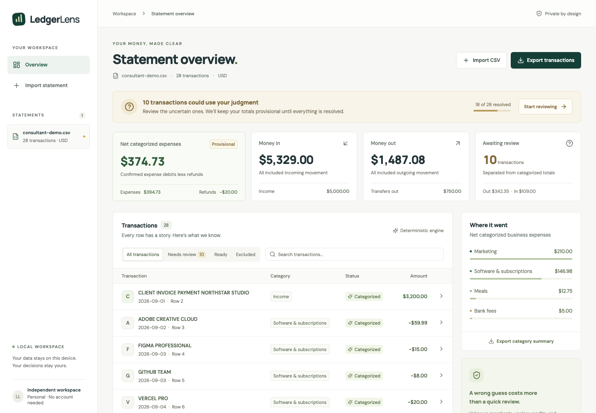

# LedgerLens

**Understand every transaction. Trust every total.**

A local statement-review workspace for independent software, design, marketing, and consulting professionals preparing records for an accountant. Upload a CSV, confirm its interpretation, inspect deterministic decisions, resolve uncertainty, and export a reconciled handoff.

LedgerLens deliberately abstains when the description does not justify a decision. A positive credit is not automatically income. A transfer is not spending. An identical row is a warning, not permission to delete it.

## What works

- CSV preview and explicit column, date, currency, and amount-direction mapping.
- Atomic validation: an invalid row prevents the entire import, with source line numbers.
- Pure Python categorization with versioned rules, evidence traces, conflict detection, and honest uncertainty.
- Separate expenses, refunds, income, transfers, personal activity, and unresolved amounts.
- Persistent manual corrections, reset to the original engine decision, and an audit history.
- Duplicate warnings with explicit keep/exclude/undo actions; at least one copy must remain.
- Backend-only accounting, checked reconciliation invariants, and matching CSV exports.
- Consistent transaction/totals snapshots, stale-edit protection, and an explicit reload recovery action.
- Search, review filters, next-review navigation, responsive layouts, and synthetic examples.
- Local SQLite storage; no runtime LLM, bank connection, account, or paid service.

## Quick start

Requirements: **Python 3.12+**, **Node.js 22.12+ (22 LTS), 24, or 26**, npm, and Git. Development was verified on macOS with Python 3.14 and Node 26. Install dependencies with internet access; the built application then runs locally without external services. Font assets are bundled.

From the repository root:

```bash
python3 -m venv .venv
source .venv/bin/activate
python -m pip install -r backend/requirements.lock
npm --prefix frontend ci
npm --prefix frontend run build
python -m uvicorn app.main:app --app-dir backend --host 127.0.0.1 --port 8000
```

Open **http://127.0.0.1:8000**. The backend serves both `/api` and the compiled frontend. Build before starting the server so static assets are mounted.

Windows: activate with `.venv\Scripts\Activate.ps1` in PowerShell; the remaining commands are the same. Windows is not a tested platform in this submission.

For frontend development, run the backend with `--reload`, then in another terminal:

```bash
npm --prefix frontend run dev -- --host 127.0.0.1
```

Open the URL Vite prints. Its `/api` proxy targets port 8000. API documentation is available at **http://127.0.0.1:8000/docs**.

### Try the example

Choose **Import your first statement → Explore the synthetic example**. The fictional consultant statement has 28 transactions, including an Adobe refund, savings transfers, unknown credits, a cafe purchase, and duplicate candidates. Confirm USD, ISO dates, and negative amounts as outgoing.

Sample files are in [`samples/`](samples/). Every name and transaction is synthetic. No real statements or personal financial details are included. To generate a larger synthetic CSV:

```bash
python scripts/generate_statement.py --rows 5000 > /tmp/ledgerlens-large.csv
```

## Supported CSV contract

| Setting | Supported behavior |
|---|---|
| Encoding / separator | UTF-8 with optional BOM; comma-separated; quoted commas and multiline descriptions |
| File / row bounds | 2 MiB; 5,000 nonblank transaction rows; 50 columns |
| Headers | Required, nonempty, unique; map explicitly in the UI |
| Dates | `YYYY-MM-DD`, `DD/MM/YYYY`, or `MM/DD/YYYY`, selected for the whole file |
| Amounts | Signed amount **or** nonnegative debit/credit columns; only one split amount may be nonzero |
| Number syntax | Decimal point, at most 2 decimals, correctly grouped optional thousands commas; `(12.50)` means negative |
| Direction | Confirm whether negative or positive signed values mean money out; split debit always means money out |
| Currency | One currency per statement: USD, PKR, GBP, EUR; no conversion |
| Limits | ±10 billion currency units per row; descriptions up to 1,000 characters |

Unsupported: PDF/OCR, decimal-comma amounts, currency symbols in numeric cells, mixed date formats, exponent notation, real-time bank feeds, mixed currencies, and automatic cross-statement deduplication. An explicit `Currency` column, if present, must agree with the selected currency. Additional unrelated columns are ignored; source descriptions and amounts are preserved. Blank lines are counted and ignored. Footers/totals are not silently removed.

Validation is atomic: fix the reported rows in the CSV and retry. Re-importing identical bytes with identical settings opens the existing statement and preserves its decisions.

## Understanding the totals

- **Money in/out:** all included cash movement, including pending review items.
- **Net categorized expenses:** accepted business expense debits minus accepted expense refunds. Refunds may exceed purchases in the current statement.
- **Awaiting review:** money that is still unresolved, kept separate from categorized totals.
- **Duplicate candidates:** included in cash movement, unresolved in category totals until kept or excluded.
- **Excluded duplicates:** remain visible and exportable, but are excluded from included totals.
- **Transfers/personal activity:** tracked separately; never added to business spending.

Expand **Reconciliation & cash movement** to inspect the accounting identities. Transactions and summary exports derive from the same backend records. Unfinished exports include provisional/review status; final exports require all review items resolved. A heuristic evidence score is not a calibrated probability. Categories organize bookkeeping; they do not determine tax deductibility.

## Verification

From the root with the virtual environment active:

```bash
python -m pytest backend/tests -q
python -m ruff check backend
python -m ruff format --check backend
npm --prefix frontend run check
npm --prefix frontend run test
npm --prefix frontend run build
```

Browser verification (build first):

```bash
cd frontend
npx playwright install chromium
npm run test:e2e
```

Playwright starts a dedicated backend on port 8011 with a separate temporary database. It does not mutate the application's default database. Tests cover desktop, mobile, invalid imports, full review/export, and automated accessibility. Automated accessibility checks do not substitute for a human assistive-technology audit.

Exact executed outcomes, timing, and screenshots are recorded in [`evidence/verification.md`](evidence/verification.md). The current dependency stack emits a Starlette warning that its HTTPX test adapter is deprecated; it does not indicate a failing test and has not been suppressed.

## Data and safety

SQLite data lives in `data/ledgerlens.db`, ignored by Git. Override with `LEDGERLENS_DB=/path/to/file.db`. Deleting a statement requires confirmation and cascades only to that statement's transactions/review history. Source files are never edited. Original upload bytes are processed in memory and are not retained as files.

Bind to loopback as documented. This is a **single-user local application**, without authentication, encrypted storage, or production multi-tenant isolation. Do not expose it on a public interface. Cross-site browser writes are rejected; SQL is parameterized; exports escape spreadsheet-formula prefixes in untrusted text. App logs do not include transaction descriptions or CSV contents.

## A two-minute walkthrough

1. Import the example and confirm interpretation.
2. Open Adobe Creative Cloud and inspect the evidence trace.
3. Contrast the Adobe refund, savings transfer, and unexplained incoming payment.
4. Review the cafe purchase and watch totals update; reload to verify persistence.
5. Keep one duplicate candidate and exclude the other; inspect reconciliation.
6. Export transactions and the category summary.

## Design and assessment notes

- [`DESIGN.md`](DESIGN.md): decisions, invariants, architecture, and tradeoffs.
- [`AI_USAGE.md`](AI_USAGE.md): actual assistance, observed errors, and sanitized usage evidence.
- [`TASK.md`](TASK.md): unchanged original assessment requirements.
- [`SUBMISSION.md`](SUBMISSION.md): original repository README/submission instructions.

Remembered merchant rules, PDF parsing, deployment, authentication, and cross-statement matching are intentionally out of scope. The versioned merchant rule file is configurable in code and covered by tests; there is no user-defined regex execution.

## Screenshots

Actual browser captures using the synthetic example (including a saved cafe correction):



[Review panel](evidence/desktop-review.png) · [Mobile workspace](evidence/mobile-overview.png)
