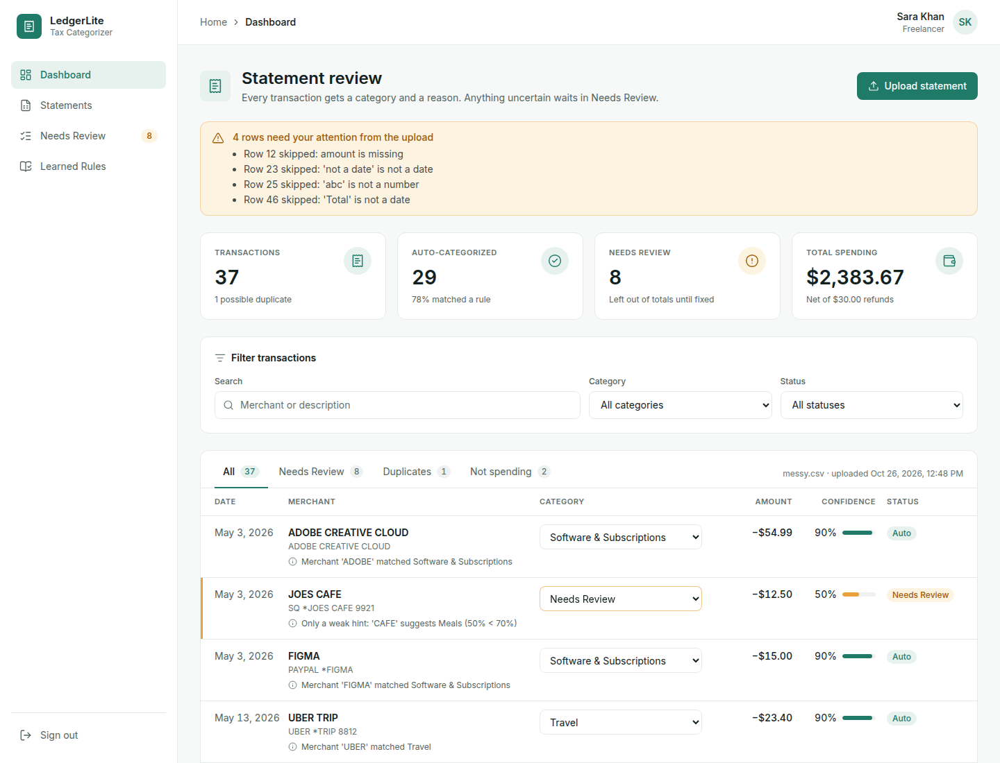

# LedgerLite — Statement Categorizer

LedgerLite sorts a freelance designer's business credit card statement for tax time.
Upload a CSV and every transaction gets a category, a confidence score and a short reason.
If the app is not sure, the row goes to **Needs Review** instead of getting a guess. You fix
those rows, the app remembers the fix for that merchant, and you get category totals and a
CSV export.

The categorizer is our own rule-based Python code (`backend/app/engine/`). **No LLM decides
anything.** See [DESIGN.md](DESIGN.md) for how it decides, and [AI_USAGE.md](AI_USAGE.md) for
how AI tools were used to build it.



## Quick start (Docker)

```bash
docker compose up --build
```

- App: <http://localhost:3000> — click **Try with sample statement**
- API docs (Swagger): <http://localhost:8000/docs>

## Run without Docker

Requirements: Python 3.11+, Node 20+ (npm).

```bash
# Backend
cd backend
python3.11 -m venv .venv
.venv/bin/pip install -e ".[dev]"
.venv/bin/uvicorn app.main:app --reload --port 8000

# Frontend (second terminal)
cd frontend
npm install
cp ../.env.example .env.local     # NEXT_PUBLIC_API_URL=http://localhost:8000
npm run dev
```

Configuration is via environment variables (see [`.env.example`](.env.example)):
`DATABASE_URL` (SQLite by default), `CORS_ORIGINS`, `MAX_UPLOAD_MB`, `NEXT_PUBLIC_API_URL`.
There are no secrets.

## Tests and lint

```bash
cd backend
.venv/bin/pytest --cov=app        # 145 tests: parser, normalizer, rules, brain, API
.venv/bin/ruff check . && .venv/bin/ruff format --check .

cd ../frontend
npm run lint && npm run build
```

GitHub Actions ([`.github/workflows/ci.yml`](.github/workflows/ci.yml)) runs all of the
above on every push, plus a check that no LLM SDK is referenced in the app code.

## Sample data

All data is fake. Files are in [`sample_data/`](sample_data):

| File | Layout | What it exercises |
| --- | --- | --- |
| `bank_a.csv` | `Date,Description,Amount`, MM/DD/YYYY | clean export, refunds, transfers, fees, unknowns, foreign currency |
| `bank_b.csv` | `Txn Date,Details,Debit,Credit`, ISO dates | split debit/credit columns, `SQ *` / `PAYPAL *` / `TST*` prefixes, ties |
| `messy.csv` | preamble lines, `Amount (USD)`, mixed date formats | `(54.99)`, `"1,250.00"`, `$-48.20`, duplicate row, broken rows, a `Total` line |

The app's **Try with sample statement** button loads `messy.csv`.

## Project layout

```
backend/
  app/
    engine/        the brain: normalizer, rules.yaml + loader, classifier, duplicates
    parsing/       tolerant CSV reader
    api/routes.py  FastAPI endpoints (contract: docs/api-contract.md)
    services.py    parse → classify → store, fixes + learning, totals, export
    models.py db.py config.py main.py
  tests/
frontend/          Next.js (App Router) + TypeScript + Tailwind + lucide-react
sample_data/       fake CSV statements
docs/              API contract, AI usage screenshots
```

## API

| Method | Path | Purpose |
| --- | --- | --- |
| POST | `/api/statements` | Upload a CSV (≤ 5 MB) → categorized rows |
| POST | `/api/statements/sample?name=messy` | Load a bundled fake statement |
| GET | `/api/statements` · `/api/statements/{id}` | List / read statements |
| GET | `/api/statements/{id}/summary` | Category totals |
| GET | `/api/statements/{id}/export` | Download categorized CSV |
| PATCH | `/api/transactions/{id}` | Change a category (and learn the merchant) |
| GET / DELETE | `/api/rules/learned[/{id}]` | View / forget learned rules |
| GET | `/api/health` · `/api/categories` | Health check, category list |

Full request/response shapes: [docs/api-contract.md](docs/api-contract.md).
