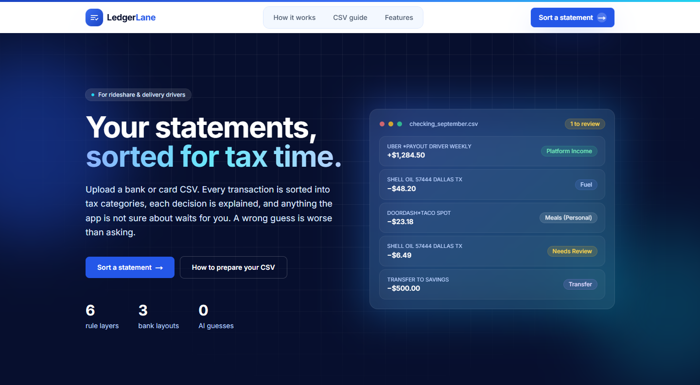
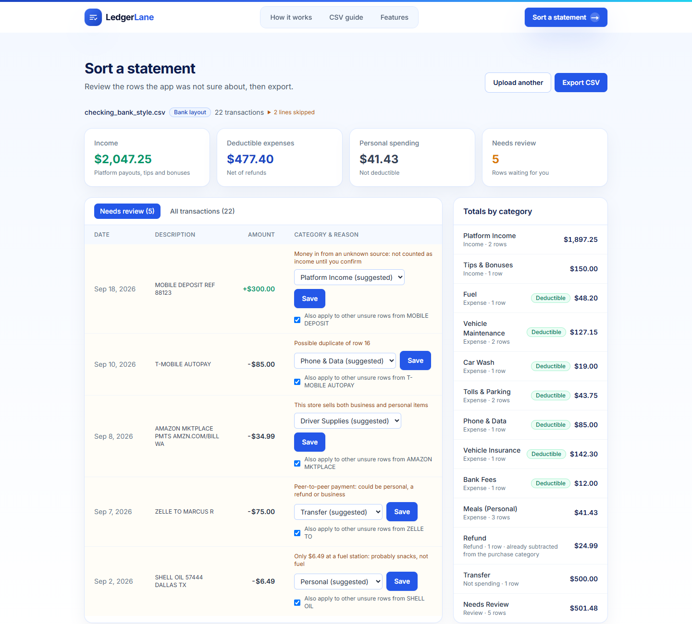
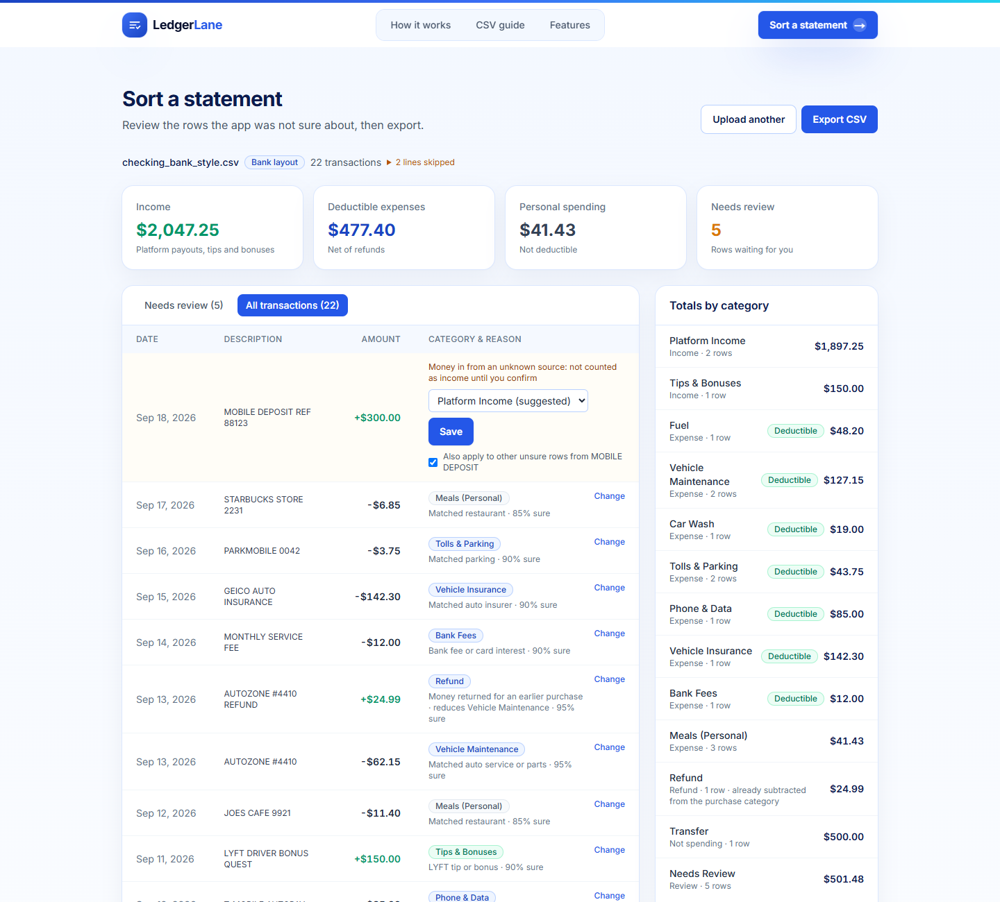
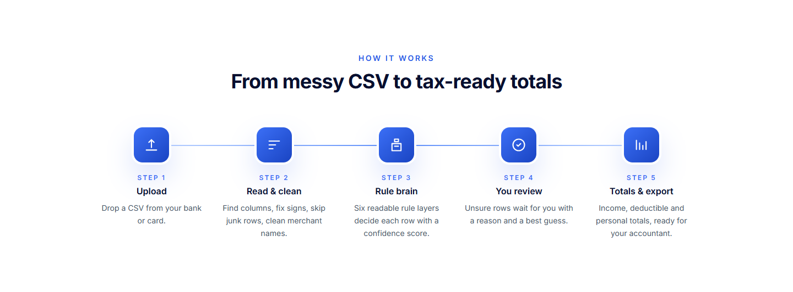
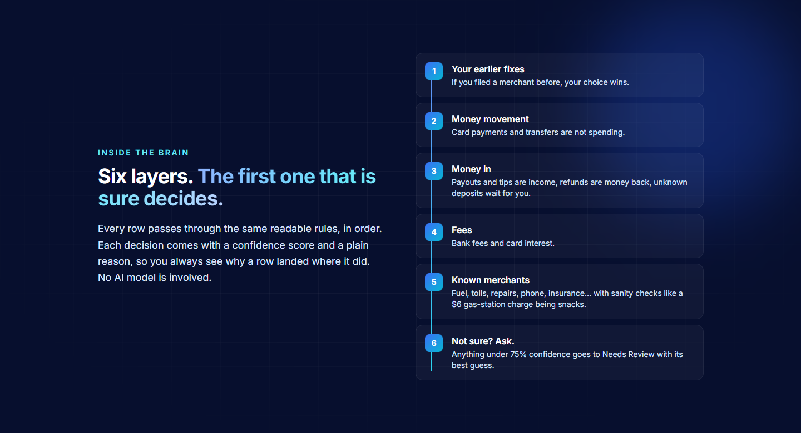
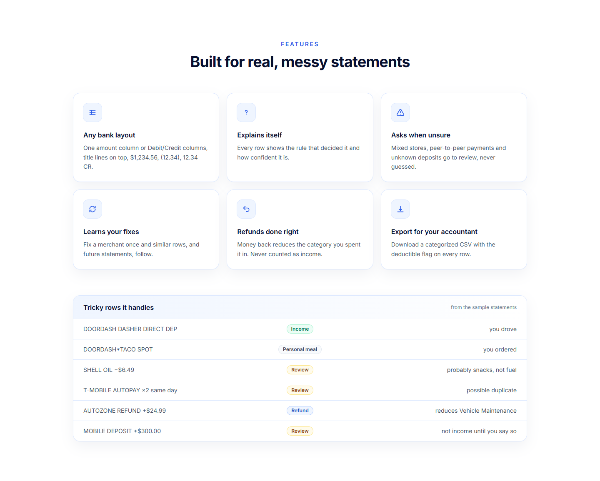
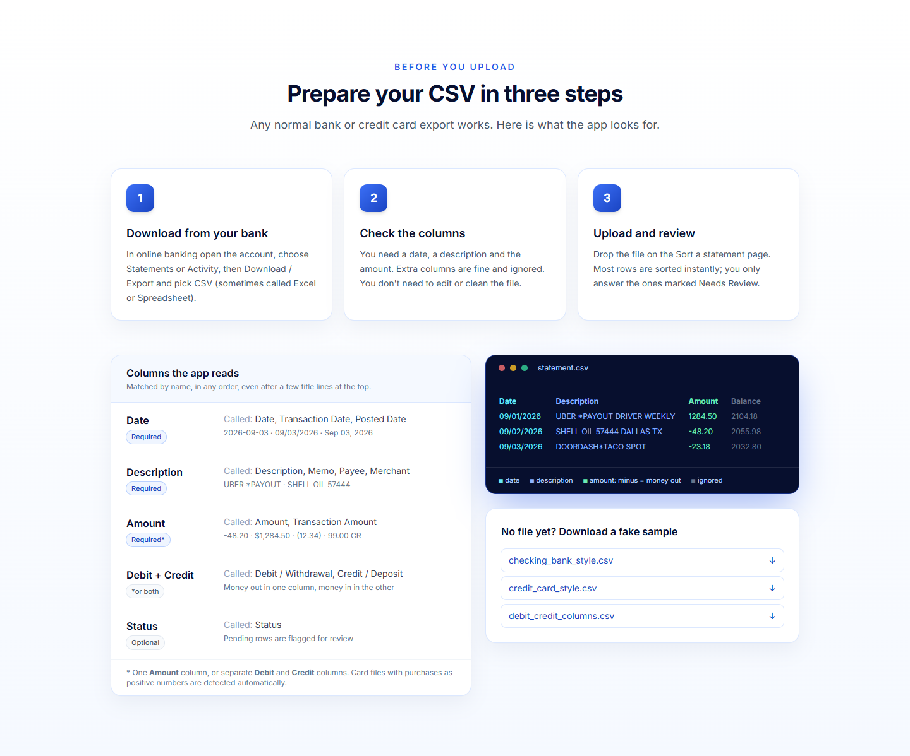
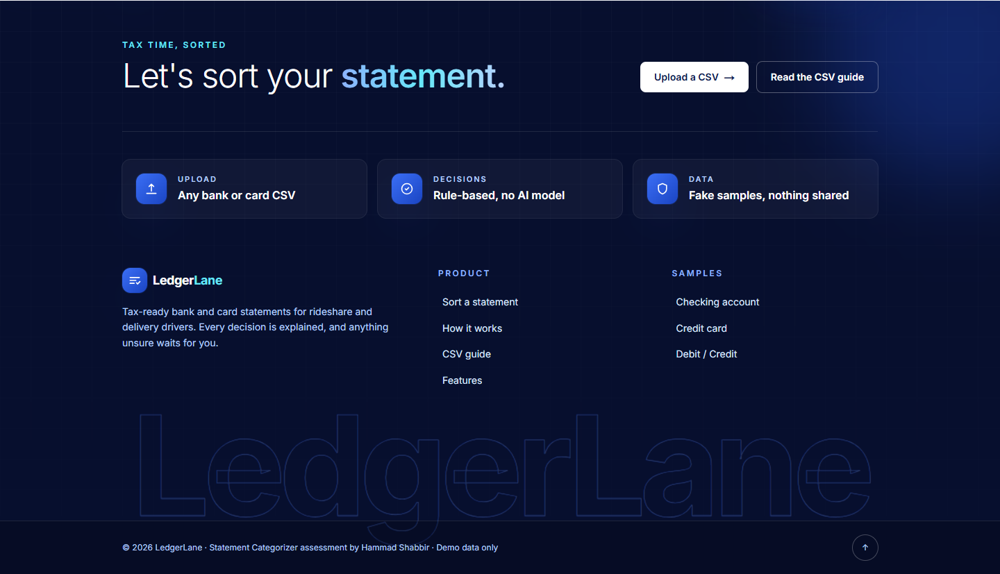

# LedgerLane: Statement Categorizer for gig drivers

Upload a bank or credit card statement (CSV). LedgerLane sorts every transaction into tax categories for a
rideshare / delivery driver, explains each decision, flags the ones it is not sure about for review, and gives totals
and a CSV export.

The decision-making "brain" is plain, readable Python rules. **No AI model decides any category.**
See [DESIGN.md](DESIGN.md) for how it decides and [AI_USAGE.md](AI_USAGE.md) for how AI tools were used to write it.
The assessment brief is in [TASK.md](TASK.md).

## Screenshots

**Landing page: header and hero**



**The app: rows that need review.** A sample bank statement after upload: totals at the top, the unsure rows with the
reason and a suggested category, and totals by category on the right.



**The app: all transactions**, each with its category, the rule that decided it and how sure it is.



**How it works**



**The brain: six rule layers**



**Features**



**CSV guide**



**Footer**



## Project structure

```
backend/                    Python 3.12, FastAPI, SQLite
  app/
    main.py                 FastAPI app, CORS
    api/routes.py           HTTP endpoints
    brain/engine.py         the decision engine (six rule layers)
    brain/rules.py          patterns, merchants and thresholds (data)
    domain/categories.py    category list: kind and deductible flag
    ingest/parsing.py       CSV reader: columns, signs, amounts, dates, junk rows
    ingest/normalize.py     merchant-name cleaning
    services/statements.py  duplicates, pending, refunds, totals
    storage/db.py           SQLite: statements, transactions, learned rules
  tests/                    pytest: parser, normalizer, brain, service, API
frontend/                   Next.js 15, TypeScript, Tailwind
  src/app/page.tsx          landing page
  src/app/categorize/       the app: upload, review, fix, export
  src/components/           landing/, categorize/, layout/, ui/
  src/lib/                  API client, types, formatting
samples/                    fake statements in three bank layouts
```

## Run locally

Requirements: Python 3.12+, Node 20+.

**Backend** (http://localhost:8000, API docs at `/docs`):

```bash
cd backend
python -m venv .venv
# Windows: .venv\Scripts\activate    macOS/Linux: source .venv/bin/activate
pip install -r requirements-dev.txt
uvicorn app.main:app --reload --port 8000
```

**Frontend** (http://localhost:3000):

```bash
cd frontend
cp .env.example .env.local   # NEXT_PUBLIC_API_URL=http://localhost:8000
npm install
npm run dev
```

Open http://localhost:3000, click **Sort a statement**, and upload a file from `samples/` (or click one of the sample
buttons).

**Or with Docker:**

```bash
docker compose up --build
```

## Tests

```bash
cd backend && pytest          # 67 tests
cd frontend && npm run lint && npm run build
```

CI runs both on every push (`.github/workflows/ci.yml`).

## API

| Method | Path | Purpose |
|---|---|---|
| `POST` | `/api/statements?sign=auto\|bank\|card` | Upload a CSV; returns rows, decisions and totals |
| `GET` | `/api/statements` | List uploaded statements |
| `GET` | `/api/statements/{id}` | One statement with rows and totals |
| `PATCH` | `/api/transactions/{id}` | Fix a row `{category, apply_to_similar, remember}` |
| `GET` | `/api/statements/{id}/export.csv` | Categorized CSV export |
| `DELETE` | `/api/statements/{id}` | Delete a statement |
| `GET` | `/api/categories` | Category list |

## Configuration

| Variable | Default | Used by |
|---|---|---|
| `CATEGORIZER_DB` | `backend/data/app.db` | backend SQLite path |
| `CORS_ORIGINS` | `http://localhost:3000` | backend, comma-separated |
| `NEXT_PUBLIC_API_URL` | `http://localhost:8000` | frontend |

No keys or secrets are needed. All data in `samples/` is fake.
