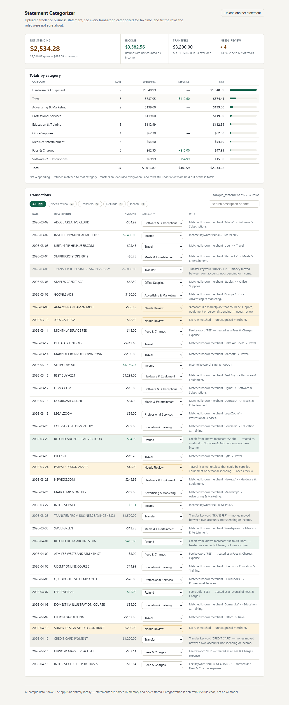
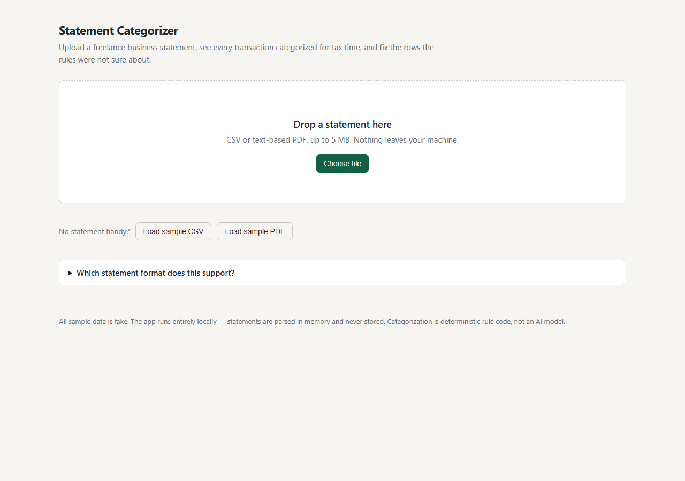
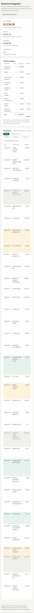

# Statement Categorizer

A local-first web app that reads a freelance designer's business bank/credit-card statements,
categorizes every transaction for tax time with deterministic rules plus a small locally
trained text classifier (no external AI, no LLM, nothing leaves the machine), and shows
exactly **why** each row was classified the way it was — so unknown merchants land in
**Needs Review** instead of being guessed.



## The use case

A freelance designer sorts a business card statement once a quarter. The app puts
`ADOBE CREATIVE CLOUD` under **Software & Subscriptions**, `UBER *TRIP` under **Travel**,
keeps `TRANSFER TO BUSINESS SAVINGS` out of spending entirely, books a `REFUND ADOBE`
credit as a refund that offsets software spending (not new income), and sends
`JOES CAFE 9921` — a merchant it does not know — to **Needs Review**. At the end the user
sees a total per category and fixes the review rows with two clicks; the summary updates
immediately.

## Features

- Upload a **CSV** or **text-based PDF** statement (drag & drop or file picker, 5 MB limit).
- Parsing that tolerates real-world exports: BOM/CRLF, preamble lines, extra columns,
  semicolon delimiters, `$1,234.56` / `(54.99)` / `54.99 DR` amounts, several date formats.
  Bad rows are reported as warnings, never silently dropped.
- Deterministic rule engine with explicit merchant and transaction-type rules; every row
  carries a human-readable reason and a rule id.
- A **locally trained text model** (scikit-learn TF-IDF + logistic regression, trained in
  seconds at startup on hand-labeled examples) catches ordinary spending wording the exact
  keyword rules miss — e.g. `DELTA AIRLINES TKT 016441` when the rules only know
  `DELTA AIR`. It only fires on debits, only above conservative confidence gates
  (`ML_MIN_SCORE=0.65`, `ML_MIN_MARGIN=0.15`), and degrades silently back to rules-only
  if scikit-learn is missing. Rows it classifies carry `method: "ml"` plus a confidence.
- Correct treatment of the tricky cases:
  - **Transfers** (to/from own accounts, card payments) are excluded from spending *and* income.
  - **Refunds** offset the spending category they belong to and never inflate income.
  - **Fees** (including fee reversals) are their own category.
  - **Ambiguous marketplaces** (Amazon, PayPal, …) are never auto-categorized.
  - Anything unrecognized goes to **Needs Review** and is held out of the totals.
- Summary: net spending (gross − refunds), income, transfers excluded, count/amount held
  for review, and a per-category table with spending / refunds / net.
- Fix any row's category from a dropdown; totals recompute immediately.
- Filters (All / Needs review / Transfers / Refunds / Income) plus text search.
- Empty, loading, error and warning states throughout. All sample data is fake.

**Future work:** a learning loop where every category the user picks in a review row is
saved locally and periodically folded into the ML model, so a month of corrections trains
the app to pre-categorize the *next* statement — the reviewer's review pile shrinking as
the app learns their specific merchants. Sketched for the current architecture in
[DESIGN.md §9](DESIGN.md) (not built here: it needs real usage data collected over time,
which a 12-hour build cannot produce).

| Upload | Mobile |
| --- | --- |
|  |  |

## Quickstart

Prerequisites: **Python 3.12+** and **Node 20+**.

### 1. Backend

```bash
cd backend
python -m venv .venv
# Windows (Git Bash): source .venv/Scripts/activate  ·  macOS/Linux: source .venv/bin/activate
pip install -r requirements.txt -r requirements-dev.txt
uvicorn app.main:app --port 8000
```

### 2. Frontend (development)

In a second terminal:

```bash
cd frontend
npm install
npm run dev        # http://localhost:5173, /api requests are proxied to :8000
```

### Single-process mode (no Node needed at runtime)

Build the frontend once; the FastAPI app then serves the built UI from port 8000 directly:

```bash
cd frontend && npm install && npm run build
cd ../backend && uvicorn app.main:app --port 8000
# open http://127.0.0.1:8000
```

The UI offers **Load sample CSV / Load sample PDF** buttons backed by
`sample-statements/` — all fake data, safe to explore with.

## Documented statement format

### CSV (preferred)

A header row plus `Date`, `Description`, and a signed `Amount` column:

```csv
Date,Description,Amount
2026-03-02,ADOBE CREATIVE CLOUD,-54.99
2026-03-02,INVOICE PAYMENT ACME CORP,2400.00
```
- Amounts are signed (expenses negative, credits positive) — **plus the real bank export
  layouts**, handled automatically (all data in tests is synthetic):
  - **Debit/Credit column pair** (Capital One, Citi)
  - **Type column** on positive amounts, Debit/Credit/Withdrawal/Deposit-style values
    (Chase). Genuinely two-sided values like `CHECK` are never guessed.
  - **Headerless Wells Fargo-style rows** (`Date, Amount, Check number, Description`)
  - currency symbols and thousands separators; parentheses or trailing minus for
    negatives; `CR`/`DR` suffixes
  - If the file lists **charges as positive** (e.g. some American Express exports —
    the opposite of the usual convention), select **"Charges are positive"** on the
    upload screen; mixed-sign files of this kind parse with a warning instead of a
    rejection.
- **Date** formats: `2026-03-14` (primary), `2026/03/14`, `03/14/2026`, `03/14/26`,
  `14-Mar-2026`, `14 Mar 2026`, `Mar 14, 2026`. Ambiguous numeric dates read as US
  month/day/year.
- Tolerated extras: a preamble above the header, additional columns (ignored), quoted
  fields, `;` or tab delimiters, UTF-8 (with BOM) / CP1252 encoding.
- Files where sign still cannot be determined (all-positive, no Type column, no
  Debit/Credit pair) are rejected with an explanation — the parser refuses to guess
  rather than miscategorize the whole statement.
- Unparseable rows are skipped and reported as warnings in the UI.

#### Bank export layouts verified (synthetic data only)

The parser is exercised against format-accurate copies of major US banks' CSV exports —
the layouts, not anyone's actual data (see the repo rules: no real statements, no real
personal details). Fixtures live in `backend/tests/fixtures/realworld/` and are proven
both by unit/API tests and by end-to-end browser runs:

| Bank-style layout | Columns / convention | Supported how |
| --- | --- | --- |
| Chase card/checking | `Details, Posting Date, Description, Amount (signed), Type, Balance, …` | Automatic (Type corroborates signs) |
| Capital One card | `Transaction Date, Posted Date, Card No., Description, Category, Debit, Credit` | Automatic (Debit/Credit pair) |
| Citi card | `Status, Date, Description, Debit, Credit` | Automatic (Debit/Credit pair) |
| Discover card | `Trans. Date, Post Date, Description, Amount (signed), Category` | Automatic (signed) |
| American Express | Charges listed **positive**, payments negative | **"Charges are positive"** upload option — never auto-guessed |
| Wells Fargo checking | Headerless rows: `Date, Amount, Check number, Description` | Automatic (strictly shaped headerless fallback) |
| Indian-bank exports (e.g. SBI-style datasets) | `date, DrCr (Db/Cr), amount, balance, mode, name, …` | Automatic — `DrCr` sets the sign; empty `name` falls back to `mode`; ATM/NEFT/IMPS/RTGS = transfers; PhonePe/Flipkart/GPay = Needs Review (ambiguous) |

Screenshots of the app processing the first, second and last of these through the real
UI: `docs/screenshots/realworld-*.png` (fake data).

### PDF

Text-based exports with one transaction per line:

```
2026-03-02  ADOBE CREATIVE CLOUD  -54.99
```

Non-matching lines (titles, column headers, page numbers) are ignored. **Scanned/image PDFs
are not supported** and are rejected with a clear message — the parser never OCRs.

## API

Base URL `http://127.0.0.1:8000`; interactive docs at `/docs`. Amounts travel as integer
cents (`amount_cents`), signed: expenses negative, credits positive.

| Method | Path | Purpose |
| --- | --- | --- |
| `GET` | `/api/health` | Liveness check |
| `POST` | `/api/upload` | Multipart `file` (`.csv`/`.pdf`) → parsed transactions, reasons, summary, warnings |
| `POST` | `/api/summary` | Recompute totals from the current transaction list (after user corrections) |
| `GET` | `/api/sample/csv` | Download the sample CSV statement |
| `GET` | `/api/sample/pdf` | Download the sample PDF statement |

Errors are JSON `{"detail": "…"}` with meaningful status codes: `400` malformed / empty,
`413` over 5 MB, `415` unsupported type, `422` readable file with zero usable transactions.

## Tests

```bash
cd backend
.venv/Scripts/python -m pytest        # Windows
python -m pytest                      # macOS/Linux
```

99 tests cover amount/date parsing, CSV variants (debit/credit columns, BOM, preamble,
malformed rows, unsigned exports), PDF parsing (generated test PDFs, scanned-PDF refusal),
every rule tier of the engine (known/unknown/ambiguous merchants, refunds, transfers, fees,
income, signed amounts), summary math (refund netting, transfer exclusion, overrides), and
the HTTP API (success, error, and total-verification cases).

## Project structure

```
backend/
  app/
    parsing/        # CSV + PDF parsers, amount/date handling, user-facing errors
    categorizer/    # rule tables + deterministic engine ("the brain")
    models.py       # Pydantic schemas (transactions, summary)
    summarizer.py   # totals by category, refund/transfer treatment
    main.py         # FastAPI app, serves frontend/dist when present
  tests/            # pytest suite
  scripts/make_sample_pdf.py
frontend/
  src/              # React + Vite app (components, styles)
sample-statements/  # fake CSV + PDF sample data
docs/screenshots/
```

## Privacy

The app runs entirely locally: statements are parsed in memory, nothing is stored, and no
third-party service is called. `sample-statements/` contains fake data only. Do not commit
real statements, keys or tokens.

---

**Assessment submission:** developed on branch `candidate-attaquarks` in
[attaquarks/savvpro-test-statement-categorizer](https://github.com/attaquarks/savvpro-test-statement-categorizer),
submitted as a PR against `savvpro/savvpro-test-statement-categorizer:main`.
See [DESIGN.md](DESIGN.md) for the decision-engine design and
[AI_USAGE.md](AI_USAGE.md) for AI tool usage.
